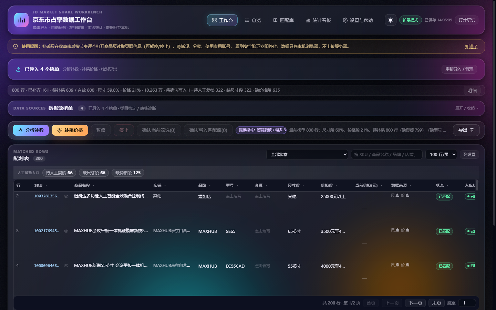
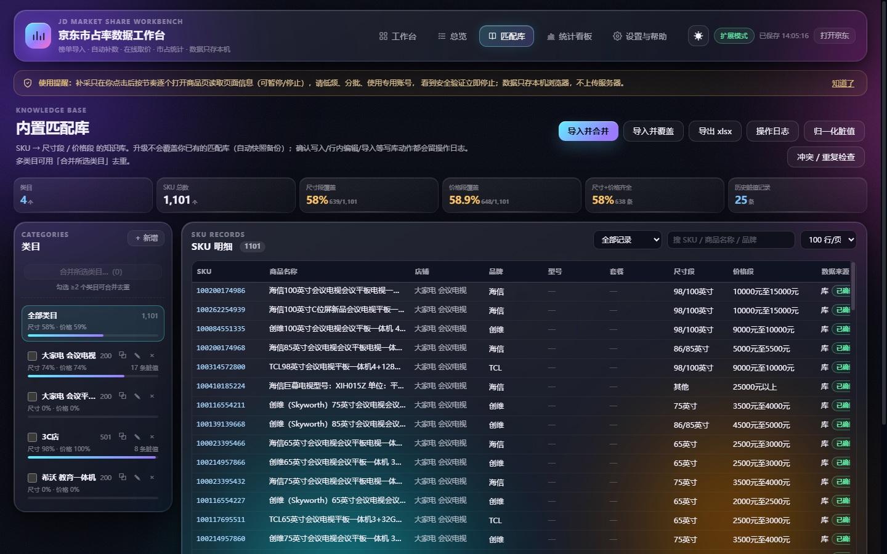
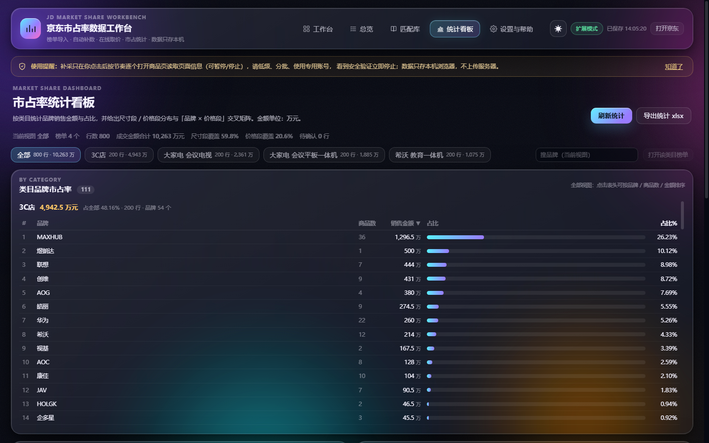
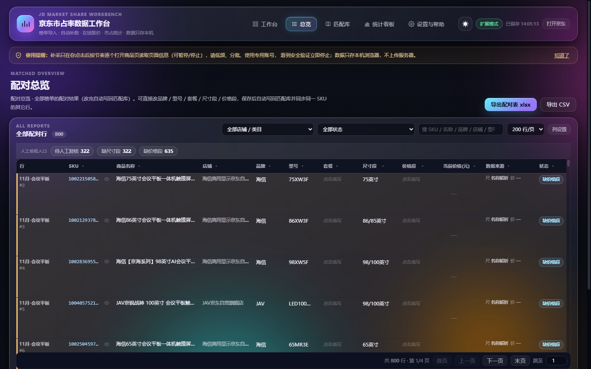

# 电商平台市占率数据工作台（Edge 扩展 v2.1.7）

把电商平台平台导出的商品榜单 Excel，变成可用于市占率统计的数据：

- **任意版本表头都能认**：自动挑数据 sheet、识别表头（`SKU ID` / `SPU ID` / `sku` 等写法都支持），识别不准时可手动点选列并记住；
- **自动绑定类目**：按 SKU 重合度把榜单绑定到内置匹配库的 4 个类目（可下拉改绑）；
- **离线补数（v2.1.6 硬规则）**：**价格只来自「匹配库该 SKU 记录」或「页面采集」，绝不由名称判断**；尺寸先看库，再按名称严格解析（名称里出现 ≥2 个尺寸表达一律留空待人工）；**4 个榜单尺寸段 478/800（59.75%）、价格段仅库命中 165/800（20.6%）**，其余靠人工定位+补采；
- **在线补采**：剩下的 SKU 用**后台标签页**按节奏打开 `item.shop.example.com` 商品页，只读页面上的价格与尺寸，换算成价格段 / 尺寸段；可暂停、停止、分批、只重采失败项；
- **关键列更全（v2.1）**：配对表/导出补齐 `SKU · 店铺 · 品牌 · 型号 · 套餐 · 尺寸段 · 价格段`，型号/套餐能从榜单列、商品名、商品页规格参数三级提取，识别不到就留空、不阻断流程；
- **多采样复核（v2.1）**：同一个 SKU 可以采 1~3 次，工具只核对多次采集是否一致、是否落在价格段边界附近；拿不准就标「需确认」交人工，**不判断价格高低对错、不拿任何标准去纠偏**；
- **白天/黑夜主题（v2.1）**：顶栏 ☀/🌙 一键切换，跟随系统或手动固定，切换即生效并记住；
- **统计类目子页（v2.1）**：统计看板顶部选一个类目，品牌市占率、尺寸段/价格段分布、品牌×价格段矩阵都只算该类目，少滚动、不串类目；
- **小眼睛预览（v2.1.2）**：鼠标悬停 SKU 旁 👁 约 0.6 秒，直接弹出一个**不抢焦点**的商品页小窗（真实 `item.shop.example.com` 页面），移开自动关；点击固定/再点关闭——不用反复开标签页就能核对商品；
- **当前价格列（v2.1.3）**：配对表/总览页/导出新增「当前价格(元)」，人工审核时直接对照「当前价格」和商品页价格是否一致（价格段由脚本匹配，一般不会错）；
- **配对总览页（v2.1.3）**：新增第 5 页「总览」，完整呈现全部 800 行配对结果，可按店铺/状态筛选、搜索，行内直接改 品牌/型号/套餐/尺寸段/价格段 并**写回匹配库**；
- **布局更顺手（v2.1.3）**：导入后导入区/数据源自动折叠，配对表占满视口（1344×756 首屏也能看到 ≥6 行），导出菜单不再被遮挡；
- **套餐口径纠正（v2.1.3）**：套餐 = 商品页「版本/套餐」里**已选中的选项**（如 `会议大屏+摄像头【免费送装一体】`），不再用标题里的内存规格猜测；旧版标题推测的套餐升级时自动清理；
- **匹配库人工核验（v2.1.4）**：新 SKU 橙色、库数据不全浅黄、待确认写入蓝色；**脚本采集/分析绝不自动写库**，只有人工点「确认写入匹配库」才写，防止未核验数据污染匹配库；
- **导出表头与界面一致（v2.1.4 BUG 修复）**：工作台/总览/配对明细/CSV **15 列**、匹配库导出 **10 列**，列名与列序和界面逐字一致（不含「操作」）；
- **频控应对（v2.1.4）**：识别电商平台首页/验证页/登录页 → 自动暂停 + 冷却 60 分钟 + 降频（5~10s、每批 20、每 8 条长休息），冷却期禁用补采并显示风控横幅；**预览人工通道**：小眼睛窗口加载后自动读数，可「采用」写入当前行（仍需人工确认入库）；
- **新内置匹配库（v2.1.4）**：改用权威版 `资料/匹配库.xlsx` 重建（**1101 SKU / 638 齐全**）；v2.1.5 升级默认 merge-missing 绝不覆盖用户库；新回归基准 尺寸 **577（72.125%）**、价格 **242（30.25%）**、品牌 **772（96.5%）**、金额 10262.6 万；
- **人工兜底**：表格里直接改尺寸段/价格段/型号/套餐，改完自动写回匹配库；
- **回填原榜单**：在原榜单文件旁生成「已补齐关键列」的 xlsx（保留全部原始列）；
- **出市占率**：按类目、尺寸段、价格段的品牌销售金额与占比，以及「品牌 × 价格段」交叉矩阵；
- **越用越快**：本次补齐的映射自动沉淀进内置匹配库，下个月直接用。

**数据只存在本机浏览器（`chrome.storage.local`），不经过任何服务器。** 不需要安装 Python / openpyxl / 本地服务，只需要 Edge。

> 本工具替代旧的「市占率报表加工程序」（Python 本地服务 + Edge 应用窗口；旧代码/旧说明书已归档到 `_archive/2026-11-02-old-python-tool/`，含 `ARCHIVE.md` 回滚说明）。旧工具的匹配库数据已迁移进本扩展的内置种子库。

---

## 界面预览

> 截图里带真实商品型号与到手价，所以仓库只保留 4 张不含业务数据的界面图（工作台 / 匹配库 / 统计看板 / 配对总览），完整 15 张见案例页。

| 工作台（深色） | 匹配库 |
|---|---|
|  |  |

| 统计看板 | 配对总览（v2.1.3） |
|---|---|
|  |  |

> 界面默认跟随系统主题（可在顶栏或设置里手动固定白天/黑夜）。完整截图共 15 张（含浅色主题、四色入库状态、确认写入、列筛选、操作日志、待人工复核、价格类型等），均在案例页的截图中。

---

## 一、安装

1. Edge 地址栏打开 `edge://extensions/`；
2. 打开左下角「**开发人员模式**」；
3. 点「**加载解压缩的扩展**」，选择本文件夹下的 `extension` 目录：
   `~/Desktop/市占率\extension`
4. 在工具栏点扩展图标，把「**电商平台市占率数据工作台**」固定到工具栏；
5. 点扩展图标 → 打开整页的「工作台」（也可以直接在地址栏打开 `chrome-extension://<扩展ID>/app.html`）。

> 更新代码后：到 `edge://extensions/` 点该扩展的「**重新加载**」，再刷新工作台页面。
>
> ⚠️ **扩展目录不要移动、不要改名**：Edge 以绝对路径加载扩展，路径一变扩展 ID 就变，`chrome.storage.local` 里的匹配库/榜单会话/采集缓存就读不到了（看起来像“数据丢了”）。确实要搬目录时，先在「设置 → 导出备份 JSON」，移动并重新加载扩展后，再「导入备份 JSON」。
>
> 扩展目录里不能存在以 `_` 开头的文件/文件夹（Edge 限制），工具脚本都放在仓库的 `tools/`、`tests/`、`dev-tools/`，不在 `extension/` 内。

## 二、使用流程（一次完整跑通）

1. **登录电商平台**：在同一个 Edge 里登录电商平台账号。补采价格需要登录态；建议用**专用账号**、低频使用。
2. **导入榜单**：工作台「导入榜单 xlsx」可一次多选 4 个榜单（也支持把 .xlsx 拖进页面）。程序自动识别每个文件的数据 sheet 与表头，每张榜单卡片会显示：文件名、识别到的 sheet、表头置信度、行数、自动绑定的类目（可下拉改绑）。v2.1 还会读榜单自带的「店铺」「型号」「套餐」列（教育教学文件就有型号/套餐列）。
3. **检查绑定**：绑定越准，库命中越高。会议电视/会议平板/教育教学一体机/3C 店/品牌A 教育一体机这些类目名在匹配库里都有对应。
4. **分析补数**（离线，几秒完成）：点「分析补数」，按 **匹配库该 SKU 记录 → 页面采集（需先补采）→ 名称严格解析尺寸** 的顺序补齐；**价格绝不由名称/同名商品推断**（v2.1.6 已删除该路径），补不上的行标「待采集」，尺寸有疑问的进「待人工复核」。
5. **补采价格**（在线，耗时取决于 SKU 数）：点「补采价格」→ 确认数量与预计耗时 → 开始。工作台会在**后台标签页**按 3–6 秒/个的节奏逐个打开商品页，读页面价格与标题/规格尺寸；可随时「暂停 / 继续 / 停止」。连续 3 个失败或遇到安全验证会**自动暂停**。**第一次用请先把「每次最多采集」设成 5~10**，跑一小批核对价格口径与尺寸是否和电商平台页面一致，确认后再放开（设 0 = 不限制）全量跑。
   - v2.1 默认「智能复核」采集模式：先采 1 次；遇到价格靠近价格段边界、取价证据弱、和同类参考价差得远等情况，会自动再采一次（最多 3 次），并在日志里写「第 2 次复核」「2 次一致 median=¥X」「价差 ¥X 标需确认」。
6. **人工核对**：点 SKU 旁的「打开」在新标签页看商品页；**鼠标悬停 SKU 旁的小眼睛 👁（约 0.6 秒）可直接弹出商品页小窗预览**（移开自动关，点一下固定）；价格可疑点该行「重采」；尺寸段/价格段/型号/套餐可在行内直接改（下拉规范值或输入自定义），保存后自动写回匹配库，下个月直接复用。多采样后仍拿不准的行会标**「需确认」**：点该行「确认」或工具条的「确认当前筛选(N)」即可人工确认，确认后状态回到「已补采」，并记录确认时间。
7. **导出**（v2.1 列说明见 3.6）：
   - 「导出 → **回填全部榜单 xlsx**」（推荐，每月一次点全）：4 个榜单各生成一个 `回填_<原文件名>_<时间戳>.xlsx`，保留原榜单全部列 + 原地填/追加「尺寸段」「价格段」「型号」「套餐」「数据来源」「复核状态」；普通榜单 19 列、教育教学文件 22 列（原表已有尺寸段/价格段/型号/套餐列，原地填，不重复加列）；文件之间自动间隔，Edge 首次可能询问「允许下载多个文件」，点允许即可；
   - 「导出 → 回填当前榜单 xlsx」：只导出当前选中榜单的回填文件；
   - 「导出 → 市占率结果 xlsx」：生成 `市占率结果_<时间戳>.xlsx`（`统计_类目` / `统计_尺寸段` / `统计_价格段` / `配对_1..n`，**有待确认行时多一个「待确认」sheet** 汇总复核原因）；
   - 「导出 → 备份 JSON」：生成 `市占率备份_<时间戳>.json`（匹配库 + 榜单会话 + 采集缓存，换电脑恢复用）；
   - 「导出 → 当前榜单筛选 CSV」：`配对明细_<日期>.csv`（当前榜单当前筛选/搜索结果的明细）。
8. **沉淀知识库**：本次补出来的映射会进入「匹配库」页，可以导出匹配库 xlsx 备份或交接。

### 2.1 统计看板：按类目看（v2.1）

打开「统计看板」，顶部有一条**类目选择条**：`全部` + 每个已绑定类目（显示 `类目名 · 行数 · 金额`）。点某个类目后：

- 「类目品牌市占率」只显示该类目的品牌表（全宽），不再 4 个类目纵向堆叠；
- 尺寸段分布、价格段分布、品牌×价格段矩阵都按该类目过滤；
- 点「打开该类目榜单」会切回工作台并把该类目的榜单设为当前榜单；
- 点 `全部` 回到汇总视图（各大类目汇总 + 类目合计）。

### 2.2 白天/黑夜主题（v2.1）

顶栏 ☀/🌙 按钮一键切换深色/浅色；默认「跟随系统」，手动切换后会记住选择（`设置 → 界面 → 主题` 也可改回跟随系统/固定白天/固定黑夜）。浅色模式下表格斑马纹、状态徽标、KPI 数字、图表、弹窗都已适配。截图见 `docs/shots/05-workbench-light.png`。

### 2.3 小眼睛预览商品页（v2.1.2）

日常核对时不用反复「打开→关标签页」：配对表每一行 SKU 文本右侧都有一个小眼睛按钮 👁（鼠标移到行上可见）：

| 操作 | 效果 |
|---|---|
| **鼠标悬停在 👁 上** | 约 **0.6 秒**后弹出商品页小窗（`item.shop.example.com/<SKU>.html`），**不抢当前窗口焦点**，你可以继续在表格里看数据 |
| **鼠标移开** | 若还没弹窗则取消；已弹出且未固定 → 约 **0.5 秒**后自动关闭（留出把鼠标移进小窗的时间） |
| **点击 👁** | 固定小窗（获得焦点，鼠标移开不关）；已固定时再点一次 → 关闭 |
| **悬停到另一行** | 自动关旧窗、开新行窗口；同一时刻只保留 **1 个**预览窗口 |
| **切到其它页面 / 开始补采 / 关闭工作台** | 自动关闭预览窗口，避免抢占焦点 |

- 窗口默认出现在**工作台窗口右侧**（不遮挡表格），右侧放不下会放左侧/居中，并按屏幕边界收进可视区域；窗口大小约 1100×820（按屏幕可用区域自适应）。
- 预览窗口里就是**真实电商平台商品页**：需要登录态；页面慢/未登录/无网络时，窗口内是电商平台自己的加载/登录/错误页，工具不做额外处理。
- **与「打开」按钮的区别**：「打开」= 在新标签页长期打开（适合仔细看/对比）；小眼睛 = 临时小窗（适合快速扫一眼、看完自动关）。
- **注意频率**：预览和补采一样会访问电商平台商品页，**不要高频来回悬停刷页面**；建议在核对数据时按需使用，遇到安全验证立即停止。

> 非扩展环境（直接双击 html 预览）没有 `chrome.windows`，小眼睛会隐藏或点击提示「预览需要在插件内使用」。

### 2.4 配对总览页（v2.1.3）

导航新增第 5 页「**总览**」：把**全部榜单的全部配对行（800 行）**放在一个表格里，适合批量核对/修改。

- 工具条：**店铺筛选**（全部 + 4 个绑定类目）、状态筛选（同工作台 6 态）、搜索（SKU/名称/品牌/店铺/型号）、每页行数（200 / 500 / 全部）、导出当前筛选 xlsx / CSV；
- 表格 15 列：`行 | SKU（带小眼睛）| 商品名称 | 店铺 | 品牌 | 型号 | 套餐 | 尺寸段 | 价格段 | 当前价格(元) | 成交金额(万元) | 采样 | 数据来源 | 状态 | 操作`；
- **行内编辑（核心）**：点 品牌/型号/套餐/尺寸段/价格段 的单元格 → 输入或从规范值下拉选择 → 保存后：
  1. 更新该行字段与来源（标「手动」），状态/复核显示同步刷新；
  2. **写回匹配库**（同一 SKU 在多个榜单出现时一起更新，下次分析直接命中）；
  3. 自动持久化 + toast「已写入匹配库（SKU …）」；
  4. 尺寸段/价格段填了非规范值 → 红框提示并拒绝保存，不改库不写行；
- 表头可点击排序（行号 / 成交金额 / 当前价格 / 尺寸段 / 价格段）；
- 未导入榜单时显示「先在『工作台』导入榜单并分析补数」。

### 2.5 当前价格列与套餐口径（v2.1.3）

- **当前价格(元)**：即采集到的「当前页面价」（多采样时取中位数，单位元）；工作台配对表、总览页、回填/结果 xlsx、CSV 都会输出该列；无采集显示 `—`。人工审核时**只需对照「当前价格」与商品页价格是否一致**（价格段由脚本匹配）。
- **套餐（口径纠正）**：套餐 = 商品页「版本/套餐」选择区里**已选中的那个选项**（例如 `会议大屏+摄像头【免费送装一体】`），不再是标题里的内存规格（`4+64GB` 之类）。来源优先级：榜单「套餐」列（离线）→ 商品页已选版本/套餐选项（采集覆盖）→ 手工填写；标题猜测已弃用，识别不到就留空。
- **旧数据升级**：升级到 v2.1.3 首次打开会清理旧版「标题推测套餐」（来源为 名称/标题/名称解析 的行），来源为 榜单列/页面采集/手动 的套餐保留；清理条数会 toast 提示，建议升级前先「导出备份 JSON」。

### 2.6 匹配库人工核验（v2.1.4）

> 核心原则：**未经人工核验的数据不写进匹配库**。脚本分析/页面采集只产出「待确认」标记，不会污染知识库。

| 行级状态 | 含义 | 颜色/徽标 |
|---|---|---|
| **已确认** | 库中记录已人工确认，且有尺寸段+价格段 | 正常 · 「已确认」 |
| **库数据不全** | 库里有这条记录，但未核验或缺尺寸段/价格段 | 浅黄 · 「库数据不全」 |
| **新 SKU** | 匹配库里没有这个 SKU | 橙色 · 「新 SKU」 |
| **待确认写入** | 自动补齐（采集/名称）后尚未确认写库 | 蓝色 · 「待确认写入」 |

- 工作台/总览新增「**入库状态**」列 + 行底色/左色条；状态筛选新增「新 SKU / 库数据不全 / 待确认写入」；KPI 新增「**待确认写入 N**」；
- 工具栏「**确认写入匹配库(N)**」= 当前筛选内 libState=pending 的行批量写库；行内也有「确认写入」；确认前会校验尺寸段/价格段合法且齐全，缺了拒绝并提示；
- 只有以下两种人工动作会写库：① 行内手动改（视为人工核验）② 点「确认写入匹配库」。**分析与采集自身永不写库**；
- 匹配库页记录显示「已确认/待确认」小徽标（不影响 11 列表头）；确认后 `settings.ui.confirmedWrites` 计数。
- 注意：未采集时 pending=1（v2.1.6 口径：名称解析/库/列补齐不算「待确认写入」，只有采集类自动补齐才标 pending）。

### 2.7 频控应对与预览人工通道（v2.1.4）

- **风险识别**：采集落地页若是电商平台首页（`www.shop.example.com` / `home.shop.example.com` / `item.shop.example.com/` 根）、登录页、安全验证页（含「安全验证/访问频繁/请验证」等文案）→ 结果带 `risk`；
- **自动冷却**：命中风险 → 立即暂停 + 冷却（默认 **60 分钟**，`settings.capture.cooldownMinutes`），进度面板显示「已触发风控，建议冷却/换账号/换网络」倒计时；**冷却期内禁止开始补采**；
- **降频默认值（保守）**：采集随机间隔 **5~10s**、每批上限 **20 条**、每 **8 条**随机长休息 **30~60s**、单标签页复用；设置页可调；
- **预览人工通道（workaround）**：小眼睛打开的商品页小窗加载后，扩展自动请求一次页面快照（到手价/电商平台价/尺寸/型号/套餐），工作台浮条显示「**预览读数：SKU · 到手价 ¥x · 尺寸 · 套餐 [采用] [忽略]**」；点「采用」= 按普通采集结果写入当前行（仍为 pending，需再人工确认入库）——人工逐条、低频，规避自动化频控；
- **被频控后的建议**：停 24 小时再采、切换电商平台账号/网络（手机热点/家宽）、把每批降到 ≤10 且间隔 ≥10s、优先用预览人工核对；**不要连续重试**。

### 2.8 表格列显隐 / 表头筛选 / 列悬停高亮（v2.1.5）

- **列设置**：配对表、总览工具条新增「列设置」按钮 → 勾选显示/隐藏非必选列（商品名称/店铺/品牌/型号/套餐/尺寸段/价格段/当前价格/成交金额/采样/数据来源/状态/入库状态/操作；`行`、`SKU` 必选）；选择持久化到 `settings.ui.tableCols`，刷新/重开保持；
- **表头列筛选**：每个表头右侧筛选按钮 → 值多选（去重值+搜索）/ 当前价格可填数值区间 / 清空；多列 AND 叠加，配合状态筛选与搜索；筛选状态在表头高亮并显示数量角标（总览页同样支持）；
- **列悬停高亮**：鼠标停在任一列（表头或单元格）→ 整列高亮（`.col-hover`），深/浅主题各一套颜色；与行 hover 并存。

### 2.9 异常自动继续：不再永久暂停（v2.1.5）

采集落地页分三类：

| 分类 | 判定 | 工具行为 |
|---|---|---|
| 已下架 `offSale` | 商品下架/不存在页 | 该行标「已下架」，**跳过继续下一条**，不暂停、不计风控 |
| 软异常 `softAnomaly` | 被跳到电商平台首页/商城页但无验证特征、空页面、跳转异常 | **等待 60 秒自动继续**（`settings.capture.anomalyWaitSec`，0=立即）；界面显示倒计时，可「立即继续」或「停止」；连续异常 ≥3 次可升级为冷却暂停 |
| 风控 `risk` | 安全验证/登录页/验证码/访问频繁 | 触发**冷却 60 分钟 + 暂停**（同 v2.1.4），提示换账号/网络 |

### 2.10 匹配库保护 · 操作日志 · 类目合并去重（v2.1.5）

- **升级绝不覆盖用户匹配库**：本次不重建内置种子（fingerprint 不变）；`applySeedMigration` 默认 **merge-missing**（只补库里缺失的 SKU，已有记录/用户改过的字段完全不动）；仅用户手动点「重置内置库」才整体替换；首次写入库前自动快照 `libraryBackup_v215`（设置页可查看备份时间并「从备份恢复」）；
- **操作日志**：所有写库动作（确认写入/手动编辑/导入合并/导入覆盖/归一化/种子迁移/类目合并/去重/增删类目）记入 `library.meta.logs`，**最多 500 条滚动**；匹配库页「操作日志」面板可查看（时间/类型/类目/SKU/字段/原值→新值/来源），支持按 SKU/类目/类型搜索并导出 CSV；
- **类目合并去重**：匹配库类目面板可多选类目 →「合并所选类目…」→ 选目标类目（可新建）→ **先预览**（合并前条数/去重后/重复数/字段冲突数与前 20 条明细）→ 确认执行；按 
ormalizeSku` 去重（忽略空格/大小写），冲突按 `verified → updatedAt 新→旧 → 字段完整度` 取值并写日志；单个类目也可「去重」；合并前自动快照，可恢复。

### 2.11 快速人工定位：待人工复核 / 缺尺寸段 / 缺价格段（v2.1.6）

- 工作台/总览工具条新增三个快捷 chip（带实时计数）：**待人工复核 N**（名称含多个尺寸/无明确尺寸，对应 sizeAmbiguous）、**缺尺寸段 N**、**缺价格段 N**；点一下即筛选，再点取消；
- 状态筛选下拉新增「尺寸待复核（名称多尺寸/无法确认）」「缺尺寸段」「缺价格段」，可与状态/搜索叠加；
- 行内：尺寸段为空的单元格显示「待人工/缺」+ 原因 tooltip；待复核行状态列标「待复核」；总览页同步可筛；导出「状态」列体现「待复核」及原因（列结构不变）；
- 目标：按「待人工复核」筛选后逐条补齐/确认，不用全量点开商品页。

### 2.12 价格采集算法（移植自巡检双轨版，v2.1.7）

本版把桌面「巡检插件-双轨版」v2.1 的商品页取价算法**整体移植**进本插件（替换原取价核心），要点：

1. **锁定当前商品价格区**：不做全页聚合；候选必须「可见、首屏内（优先）、文本是一个完整价格」，最终按**字号最大**选价（到手价=大号红字，电商平台价=旁边小号灰字）；
2. **排除无关价格卡片**：跨平台比价卡、关联购买、推荐/相似/猜你喜欢、广告/横幅、店铺卡、促销卡、足迹/历史、比价卡等容器里的价格全部跳过（源版实测旧逻辑 76% 的会员价错读自这些卡片）；
3. **只认可见元素**：`display:none`、`visibility:hidden`、`opacity<=0`、无布局尺寸、隐藏抽屉一律跳过（后台标签页也适用）；
4. **严格完整价格**：去空白后必须是一个完整价格（`¥15,699`/`15699.00`/`¥8607.56`），拒绝「56」小数片段、折扣/分期/满减/月供/评价/销量/优惠券等文本；无货币符号时整数位必须 ≥3；价格 ≥30 元；
5. **口径判定**：标签含 PLUS/会员 → `plus`；到手价/预估到手/券后 → `hand`；电商平台价/原价/划线价 → `main`；无标签按字号（≥18 到手价，否则电商平台价）；被划线 → 电商平台价；
6. **稳定性**：连续 **3 轮**（约 1.5s）读到同一价格才算稳定（最长 20s；仅主价时最多 6s 接受）；稳定后再**复核最多 4 次 × 1.2s**，以页面最终刷新后的读数为准，变化记入 `priceChanges:[{from,to}]`（**不按阈值挑值、不猜**）；
7. **上报字段**：`price / priceKind / priceKindLabel / priceRect / sourceLabel / priceChanges / candidates`（前 12 条候选含价格/口径/文本/class/字号/划线/位置）；
8. **数据来源**：显示 `页面采集(到手价)` / `页面采集(PLUS价)` / `页面采集(电商平台价)`；当前价格旁显示价格类型小徽标。

> 不采纳（已在文档说明）：① **官方价 API 桥**（巡检的 `api_bridge.py` + SP-API `price-stars`）只覆盖授权店铺**自有商品**的普惠价，竞品 SKU 不归属授权店铺，无法取数；② **AI 复核**需要 AI Key，列为后续可选（只校验不覆盖 DOM）；③ **双轨/前台小窗**：竞品批量采集用后台标签页即可，频控严重时再评估。

### 2.13 下架不计入采集进度分母（v2.1.7）

- 采集时命中「已下架」的行标记 `offSale`，**不计入进度分母**：KPI 显示「待补采 X / 有效 Y（已下架 Z 不计入）」，进度百分比按有效行计算；
- 总览页状态筛选新增「已下架」，可单独查看；导出列结构不变；
- 下架行仍保留在榜单/统计中（成交金额等口径不变），只是不算「待采集」。

### 2.14 采集调试：候选价格 JSON（v2.1.7）

- 工作台行内新增「调试」入口：弹出该行本次采集的 **候选价格 JSON**（`price / kind / text / cls / font / strike / rect` 前 12 条 + `priceChanges` + 最终 `priceKind/priceRect`），可一键复制；
- 排查取价异常时：先看「当前价格」徽标口径，再看调试 JSON 里字号最大的候选是否页面大号红字；如候选里有比价卡价格（8499/1999）或「56」片段，说明页面结构变化，把 JSON 发开发即可；
- 页面价格刷新（如 24699→25099）会记入 `priceChanges`，以最终复核价为准。

## 三、口径说明（重要）

### 3.1 尺寸段

规范枚举：`55英寸`、`65英寸`、`75英寸`、`86/85英寸`、`98/100英寸`、`其他尺寸(43英寸)`、`其他尺寸(110英寸)`、`其他尺寸(120英寸)`、`其他尺寸(150英寸)`、`其他`。

- 商品名/标题里 `75英寸`、`85寸`、`86吋` 都能识别；43/110/120/150 之外的数字（如 `其他尺寸(163英寸)`）也会保留为「其他尺寸(n英寸)」，不会丢行；
- 历史脏值会自动归一：`其他（50英寸）` → `其他尺寸(50英寸)`、`其他尺寸(120英寸）` → `其他尺寸(120英寸)`、`110英寸` → `其他尺寸(110英寸)`、`未识别` → `其他`。

### 3.2 价格段（18 段）

`1000元以下`、`1000元至2000元`、`2000元至2500元`、`2500元至3000元`、`3000元至3500元`、`3500元至4000元`、`4000元至4500元`、`4500元至5000元`、`5000元至5500元`、`5500元至6000元`、`6000元至7000元`、`7000元至8000元`、`8000元至9000元`、`9000元至10000元`、`10000元至15000元`、`15000元至20000元`、`20000元至25000元`、`25000元以上`。

- 默认边界口径 **左闭右开 `[low, high)`**：`1000 ≤ 价 < 2000` → `1000元至2000元`；`< 1000` → `1000元以下`；`≥ 25000` → `25000元以上`；
- 设置里可切换为「左开右闭 `(low, high]`」，边界值（如 2000 元）会归入下一档；
- 脏值自动归一：`3000元3500元`、`3000元-3500元` → `3000元至3500元`；`25000以上` → `25000元以上`；
- 采集到的是「**当前登录账号在页面上看到的价格**」，可能受账号/券/地区影响，每行会标来源与采集时间，允许手动改。

### 3.3 成交金额（单位：万元）

榜单 `成交金额` 是区间写法，取两个边界的中值；**真实榜单里「元」和「万元」混排**，工具都会正确换算：

| 原始写法 | 结果（万元） |
|---|---|
| `￥200万 ~ ￥400万` | 300 |
| `￥50万 ~ ￥75万` | 62.5 |
| `￥6,000 ~ ￥8,000` | 0.7 |
| `￥8,000 ~ ￥1万` | 0.9 |
| `-` / 空 / 无法识别 | 记为空并在行上标「金额异常」，不阻断流程 |

### 3.4 品牌补全（本月 3 个榜单没有品牌列）

品牌按以下优先级补全，`数据来源` 会标「列 / 库 / 名称 / 店铺」：

1. 榜单品牌列（有且非空）；
2. 匹配库同 SKU 的品牌（如 `华为（HUAWEI）` → `华为`）；
3. 商品名称里的品牌词（别名表最长匹配优先，如 `品牌B会议平板…` → `品牌B`）；
4. 店铺名称里的品牌词（如 `海信商用显示电商平台自营旗舰店` → `海信`）；
5. 都识别不出 → 留空，UI 显示「未标注品牌」，统计计入「未标注品牌」。

实测 4 个榜单品牌覆盖率 96.0% / 100% / 93.0% / 96.5%（合计 96.4%）；漏掉的行可在表格里行内改品牌。

### 3.5 状态与数据来源

| 状态 | 含义 |
|---|---|
| 已匹配 | 尺寸段+价格段都齐（来自匹配库/榜单列/页面采集） |
| 已补采 | 尺寸段+价格段都齐（含页面采集；人工确认复核后也回到这里） |
| 部分 | 只有尺寸段，缺价格段（可补采） |
| 待补 | 只有价格段，缺尺寸段（需人工补或采集标题） |
| 待采集 | 两个都缺 |
| 采集失败 | 页面取价失败（下架/风控/超时等），可重采或手动改 |
| **需确认**（v2.1） | 多次采样结果不一致、价格落在价格段边界附近、取价证据弱等，工具拿不准，等人工确认；确认后回「已补采」 |

数据来源（v2.1.6）：尺寸 `库` / `名称解析`（严格规则，仅唯一尺寸表达）/ `列` / `页面采集` / `手动`；**价格只有 `库` / `列` / `页面采集` / `手动`，不会出现「名称推断」**。

### 3.6 关键列与导出列（v2.1.3）

月度关键列：`SKU · 店铺 · 品牌 · 型号 · 套餐 · 尺寸段 · 价格段`（+ 当前价格(元) 供人工核对）。

| 字段 | 来源（按优先级） |
|---|---|
| 店铺 | 榜单「店铺/店铺名称」列；无此列时用报告绑定的类目名兜底并标注 |
| 型号 | ① 榜单「型号」列 ② 商品名称里的型号 token ③ 商品页规格参数（权威值）；识别不到留空 |
| 套餐（v2.1.3） | ① 榜单「套餐/套装/版本」列（离线，识别不到留空）② 商品页「版本/套餐」**已选中的选项**（采集覆盖，如 `会议大屏+摄像头【免费送装一体】`）③ 手工填写；**不再用标题内存规格猜测** |
| 尺寸段 / 价格段 | 规则同上文；匹配库/人工修改会沉淀复用 |
| 当前价格(元)（v2.1.3） | 采集到的页面价（多采样取中位数，单位元）；无采集为空（显示 `—`） |
| 入库状态（v2.1.4） | 已确认 / 库数据不全 / 新 SKU / 待确认写入（v2.1.5 起已核验显示「已确认」；见 2.6/2.10） |

导出列（v2.1.5，**与界面表头逐字一致，不含「操作」列**）：

- **配对明细 / 工作台 CSV / 总览导出 15 列**：`行, SKU, 商品名称, 店铺, 品牌, 型号, 套餐, 尺寸段, 价格段, 当前价格(元), 成交金额(万元), 采样, 数据来源, 状态, 入库状态`；其中「行」= `榜单简称 #行号`（与界面一致）；
- **匹配库导出 10 列**：`SKU, 商品名称, 店铺, 品牌, 型号, 套餐, 尺寸段, 价格段, 数据来源, 更新时间`；
- **回填榜单 16 列（v2.1.5 改版，界面同款）**：`行, SKU, 商品名称, 店铺, 品牌, 型号, 套餐, 尺寸段, 价格段, 当前价格(元), 成交金额(万元), 采样, 数据来源, 状态, 入库状态, 操作`；每榜单 1 个 sheet，`操作` 列留空；**不再保留原榜单列**（旧「原列+追加」口径作废）；
- **结果 xlsx**：`统计_类目` / `统计_尺寸段` / `统计_价格段` / `配对_1..4`；有「需确认」行时在统计页之后插入「**待确认**」sheet（12 列不变，第 10 列为「当前价格(元)」），没有待确认行时仍是 7 个 sheet。

### 3.7 多采样复核：只核对一致性，不判断对错（v2.1）

竞品数据**没有标准答案**，同一个页面价也会随账号/券/地区/时间波动，所以工具不做「价格高低/对错」判断，也不拿任何参考值去改采集结果：

- 采集模式（设置页可选）：
  - **智能复核**（默认）：先采 1 次；出现「价格靠近价格段边界」「取价证据弱」「与同类参考区间差得远」等疑点时，自动再采一次，最多 3 次；
  - **固定双采**：固定采 2 次，两次差值超出容差可再补，适合价格段敏感的月份；
  - **单次采集**：只采 1 次（旧行为），适合快速跑量。
- 选值规则：多次采样**一律取中位数**，不向匹配库已有值、也不向任何参考值靠拢；
- 复核判定（命中任一即标「需确认」，并把原因写进「复核状态」列和「待确认」sheet）：
  - 多次采样价差超容差（默认 `max(30 元, 价格×1%)`，可在设置里调）；
  - 多次采样落在不同价格段；
  - 价格距价格段边界很近（默认 `max(10 元, 价格×1%)`，可调）；
  - 价格明显偏离「同店铺+同尺寸段」匹配库参考区间（库样本 ≥5 才启用）；
  - 与匹配库已有价格段不一致；
  - 取价证据弱（候选不足/文本兜底）。
- 处理：筛选「需确认」→ 逐行「确认」，或工具条「确认当前筛选(N)」批量确认；确认后状态回「已补采」并记录确认时间。**工具不会自动替你确认。**

### 3.8 套餐口径：商品页已选版本，不是标题内存规格（v2.1.3）

- 套餐指商品页「版本/套餐」选择区里**已经选中的那个选项**，例如 `会议大屏+摄像头【免费送装一体】`；完整保留 `【】` 等文本，取不到就留空（不影响统计）。
- 优先级：**榜单「套餐/套装/版本」列**（离线）→ **商品页已选版本/套餐选项**（采集覆盖，权威）→ **手工填写**；旧版「从标题猜内存规格（4+64GB 等）」已弃用。
- 升级 v2.1.3 首次打开会**清理旧版标题推测套餐**（来源为 名称/标题/名称解析 的行；榜单列/页面采集/手动的套餐保留），清理条数会提示；建议升级前先「导出备份 JSON」。
- 若某行套餐为空：可点商品页确认版本后手工填，或在总览/工作台行内编辑（会写回匹配库）。

### 3.9 名称多尺寸：同一尺寸段归一，不同段不猜（v2.1.5）

- 商品名里出现多个英寸值时，先归一成**尺寸段**再判断：`98英寸 / 100英寸` 同属 `98/100英寸`、`85 / 86` 同属 `86/85英寸` → 正常识别为对应尺寸段；
- 只有落到 **≥2 个不同尺寸段**（如 `55` 与 `65`、`75` 与 `86`）才不猜：`size` 留空、`sizeAmbiguous=true`、备注「名称含多个尺寸，待人工复核」，状态按缺尺寸处理，人工补；
- 新基准（4 榜单未采集）：尺寸段 **577/800（72.125%）**、其中 `sizeAmbiguous` **157 行**、尺寸档 **22**；价格段 242、品牌 772、金额 10262.6 万不变。

### 3.10 价格与尺寸硬规则（v2.1.6，用户硬约束）

**价格绝不由名称判断，只能来自两个地方：**

1. **匹配库中该 SKU 的记录**（`source.price=库`；库是人工/权威维护的，可信）；
2. **页面采集价格**（到手价/电商平台价 → 价格段；`source.price=页面采集`）；

同名商品不补任何字段、名称里的数字/金额不产价格（`名称推断` 路径已删除，数据来源不会出现该词）。库无该 SKU → `price` 空、状态「缺价格段」，用快捷筛选定位后在线采集。新基准：**价格段 165/800（20.6%），全部来自库；待补采 635 行**（原 242 中 77 条来自名称推断，已剔除）。

**尺寸严格识别：**

- 来源顺序：匹配库该 SKU → 名称严格解析 → 页面采集（规格参数优先）→ 空置等人工；
- 名称只统计**明确尺寸表达**（数字+英寸/寸/吋）；**出现 ≥2 个尺寸表达（含 98/100、86/85、55/65、「75英寸 86英寸」）→ 一律不识别**：`size` 空 + `sizeAmbiguous=true` + 备注「名称含多个尺寸，待人工复核」；
- 型号数字（如 `75MBK7`、`VH75CAD`）和无单位数字（`5000元`、`4K`）不当作尺寸；无明确尺寸也标待复核；
- v2.1.5 的「同段归一（98/100 算 98/100英寸）」规则**作废**；单值（`65英寸`/`75寸`/`85吋`）才识别；
- 采集到页面明确尺寸后清除待复核标记；新基准：**尺寸段 478/800（59.75%）、sizeAmbiguous 322 行（多值 248 + 无明确 74）**。

## 四、设置说明

「设置与帮助」页（修改后点「保存设置」生效；采集类设置在下一次开始采集时生效）：

- **采集节奏**：每次最多采集（0=全部，首次建议先 5~10 试跑）、每个页面间隔秒数（v2.1.5 默认 **5~10 秒随机**）、**每批上限（默认 20，可 5~100，实际生效）**、单条失败重试（默认 1 次）、跳过今天已采过的 SKU、采集结束保留后台标签页（调试用）；
- **异常自动继续（v2.1.5）**：异常等待秒数（默认 **60 秒**，0=立即继续）、连续异常升级冷却阈值；
- **多采样复核（v2.1）**：采集模式（智能复核 / 固定双采 / 单次采集）、最多采样次数（2~5，默认 3）、两次采样差值容差（默认 `max(30 元, 价格×1%)` 判一致）、价格段边界敏感带（默认 `max(10 元, 价格×1%)` 内算「靠近边界」）；
- **价格口径**：采价优先级（到手价 → 电商平台价 → PLUS 价，可调顺序）、价格段边界口径（左闭右开 / 左开右闭）、合理价下限（默认 30 元，低于该值的数字片段不当作价格）；
- **界面**：白天/黑夜主题（跟随系统 / 白天 / 黑夜，默认跟随系统）；表格列显隐/行高；
- **匹配库**：内置库版本/备份时间、「从备份恢复」、操作日志入口；
- **表头映射记忆**：手动诊断过的列映射按文件名记住，可在这里查看/清空；
- **数据备份与清理**：导出备份 JSON、导入备份 JSON、清空采集缓存、清空榜单会话；
- **调试**：查看最近一次采集的原始候选价格，可一键复制调试 JSON（页面改版排查用）；
- **模块状态**：查看 7 个 lib 模块加载情况（全部正常才会显示启用）。

## 五、数据安全与换电脑迁移

- 所有数据只存本机浏览器 `chrome.storage.local`（已申请 `unlimitedStorage`），**不上传服务器**；
- 换电脑/重装：旧电脑「导出备份 JSON」→ 新电脑工作台「设置 → 导入备份 JSON」，匹配库/会话/采集缓存都会恢复；
- 想清空：设置页「清空采集缓存」「清空榜单会话」，或用 Edge 扩展管理里的「清除数据」；
- 采集缓存按 SKU 跨月复用，重复分析不会重复采集。

### 5.1 重新加载扩展/刷新页面会不会覆盖已跑数据？（v2.1.3 常见疑问）

**不会。** 扩展数据（导入的榜单 + 每行结果/状态 + 采集缓存 + 匹配库 + 设置）保存在 `chrome.storage.local`，和代码文件分离：

| 操作 | 数据是否保留 |
|---|---|
| 刷新页面（F5）/ 重新打开工作台 | ✅ 保留（自动恢复） |
| `edge://extensions/` 点「重新加载」/ 升级代码后重新加载扩展 | ✅ 保留（**扩展目录不变 → 扩展 ID 不变 → storage 原样**） |
| 升级到 v2.1.3 首次打开 | ✅ 保留，仅自动清理旧版「标题推测套餐」（来源 名称/标题/名称解析）；第一次清理前会自动把旧会话快照写入 `backup_v213` 键 |
| 升级到 v2.1.4 首次打开 | ✅ 保留；内置匹配库自动替换为新版权威数据（1101 SKU），旧库里的人工核验记录保留合并，写 `settings.ui.seedVersion`；导入榜单/采集缓存/设置不动 |
| **移动/重命名 `extension` 目录** | ❌ 扩展 ID 变化，读不到原数据（要搬先导出备份 JSON） |
| 移除扩展 / 扩展详情里「清除数据」/ 浏览器清除站点数据 | ❌ 数据丢失 |
| 工具内「清空榜单 / 清空采集缓存」 | ❌ 对应数据被清空（匹配库不受影响，除非一并清） |

> 建议：改动较大或升级前，先在设置页点「**导出备份 JSON**」；出问题可从备份恢复。

### 5.2 升级会不会覆盖我的匹配库？操作日志和备份怎么用（v2.1.5）

**不会覆盖。** 用户已在插件匹配库更新的大量内容受保护：

- 本次升级**不重建**内置种子（fingerprint 不变）；`applySeedMigration` 默认 **merge-missing**：只补库里缺失的 SKU，**已有记录、用户改过的字段完全不动**；只有用户主动点「重置内置库」才整体替换；
- 首次写库前自动快照 `libraryBackup_v215`（设置页显示备份时间，可「从备份恢复」）；
- 所有写库动作都记**操作日志**（匹配库页「操作日志」）：确认写入/手动编辑/导入/归一化/种子迁移/类目合并/去重，最多 500 条滚动，可按 SKU/类目/类型搜索并导出 CSV；
- 合并/去重前自动快照，操作可恢复；「从备份恢复」不会影响当前榜单/采集缓存。

## 六、合规与风控提醒（请务必遵守）

- 插件**只在你手动点击后**工作：在后台标签页打开商品页、**只读页面 DOM**，不调用电商平台接口、不提交订单、不修改任何数据；
- 默认节奏 3–6 秒/个，并支持分批、暂停、停止、只重采失败项——请保持低频，**不要做无人值守的高频抓取**；
- 建议用**专用账号**采集，主账号只做人工查看；
- 日志出现「页面要求安全验证」等提示时，**立即停止**、降低频率，不要连续硬跑；
- 采集结果只用于内部经营分析，不对外传播原始页面数据。

## 七、常见问题

| 现象 | 处理 |
|---|---|
| 加载扩展报 `Cannot load extension with file or directory name _xxx` | 扩展目录里不能有 `_` 开头的文件/文件夹；本工具的脚本都在 `tools/`、`tests/`、`dev-tools/`，不要放进 `extension/` |
| 点扩展图标没反应 | `edge://extensions/` 确认已启用并「重新加载」；或直接在地址栏打开 `chrome-extension://<扩展ID>/app.html` |
| 导入榜单后提示「没有识别到 SKU 列」 | 点「表头诊断」，在预览里点选 SKU/商品名称/品牌/成交金额/店铺列，保存后按文件名记住，下次自动套用 |
| 数据 sheet 挑错了 | 「表头诊断」里可看到当前选中的 sheet；确认文件里数据页与说明页分开（如「尺寸段和价格段」是说明页，会被自动跳过） |
| 补采一直失败/超时 | 确认 Edge 已登录、能手动打开 `item.shop.example.com` 商品页；确认没有跳到登录页/验证页；把「每次最多采集」调小先试跑；被风控时立即停止 |
| 采到的价格和人工看的差一点 | 页面价格受账号/券/地区影响属正常；每行有来源与时间，点「改」手动修正 |
| 采集后很多行标「需确认」 | 说明多次采样不一致/靠近价格段边界/证据弱，工具不替你下结论：筛选「需确认」逐行看商品页，点行内「确认」；或用「确认当前筛选(N)」批量确认。想少打扰可在设置里把采集模式改成「单次采集」 |
| 同一 SKU 采到的价格每次不一样 | 属正常波动；工具取多次采样的中位数并记录价差，差异大就标「需确认」，不会拿任何参考值去改结果 |
| 型号/套餐列很多是空的 | 型号：商品名/页面没有型号就留空；**套餐（v2.1.3）只认榜单列或商品页已选版本**，标题内存规格不再猜，识别不到留空属正常（不影响统计）；可在表格/总览行内手动补，补过的会写回匹配库 |
| 回填文件为什么普通榜单 20 列、教育教学 23 列（v2.1.3） | 原表已有的列（尺寸段/价格段/型号/套餐）会原地填，只追加缺的列 + 当前价格、数据来源、复核状态；教育教学文件原本已有四列，所以只多 3 列 |
| 结果 xlsx 里多了一个「待确认」sheet | 有需确认行时自动生成，汇总复核原因；全部确认后再次导出就没有这个 sheet（回到 7 个 sheet） |
| 统计看板只想看一个类目 | 点统计页顶部类目选择条里的类目；点「全部」回到汇总视图，「打开该类目榜单」可跳回工作台 |
| 想要浅色界面/夜间截图 | 顶栏 ☀/🌙 切换，或在「设置 → 界面 → 主题」固定白天/黑夜；默认跟随系统 |
| 采集失败的行怎么处理 | 点该行「重采」；仍失败就手动改尺寸段/价格段；也可勾选/筛选后批量重采 |
| 统计里某行品牌是「未标注品牌」 | 品牌链路没识别出来，表格里行内改品牌即可（会写回匹配库） |
| 表格里改完，下次还要改吗 | 不用：改动会写回匹配库，下个月同 SKU 直接命中 |
| 换电脑/重装 Edge | 用「备份 JSON」导出/导入；匹配库也可单独「导出 xlsx」交接 |
| 想清空重来 | 设置 → 清空采集缓存（不影响匹配库）/ 清空榜单会话；或用扩展管理里的清除数据 |
| 导出文件打不开 | 确认导出的是 xlsx（不是改了扩展名）；Excel 若提示格式，用「是」打开；文件在浏览器默认下载目录 |
| 和旧 Python 工具的匹配库怎么衔接 | 内置种子 `extension/data/base-skus.json` 已用 2026-11-03 权威版 `资料/匹配库.xlsx` 重建（4 类目 **1101 SKU / 638 条齐全**，不再合并旧 legacy 脏数据）；后续在匹配库页「导入并合并」旧库导出文件即可增量合并 |
| 小眼睛预览窗口空白/一直加载/显示验证页（v2.1.2） | 预览窗口加载的是真实电商平台商品页：先确认已登录电商平台、网络正常；网络慢时会看到电商平台自己的加载页；未登录/访问频繁时可能被电商平台拦到验证页（`pc-frequent-pro.pf.shop.example.com`），退出重登/稍后重试即可；仍不行就点该行「打开」在新标签页查看 |
| 小眼睛点了没反应/不出现 | 悬停需停留约 0.6 秒才弹出；确认当前是插件内页面（非直接打开的 html）；若提示「预览需要在插件内使用」，请从扩展图标进入工作台 |
| 预览窗口能固定吗/怎么关 | 点一下小眼睛即固定（再点关闭）；不点固定时鼠标移开约 0.5 秒自动关；切页/开始补采也会自动关 |
| 小眼睛预览会不会太频繁被风控（v2.1.2） | 预览同样访问电商平台商品页，请按需使用、不要高频来回悬停；遇到安全验证立即停止，与补采保持同样的低频原则 |
| 「当前价格(元)」列是什么/为什么是 `—`（v2.1.3） | 是采集到的当前页面价（多采样取中位数）；`—` 表示这行还没补采，点「补采价格」后出现；人工审核时对照它和商品页价格即可 |
| 「当前价格」和商品页显示不完全一样 | 页面价受账号/券/地区/时间影响，差一点属正常；多采样会标「需确认」；也可在总览页手动修正来源/数值（价格段仍按规则匹配） |
| 配对表只看当前榜单，想一次看全部（v2.1.3） | 打开导航「总览」页：全部 800 行、店铺/状态筛选、搜索、每页行数（200/500/全部），改 品牌/型号/套餐/尺寸段/价格段 会写回匹配库 |
| 总览页改完参数，匹配库会变吗（v2.1.3） | 会：行内保存会同步写入匹配库（同一 SKU 多行一起更新），并自动持久化；下次分析同 SKU 直接命中 |
| 刷新页面/重新加载扩展，之前跑的数据会没吗（v2.1.3） | 不会。数据在 `chrome.storage.local`（session/captures/library/settings），扩展目录不变则 ID 不变、数据保留；只有移动/重命名 extension 目录、移除扩展、清站点数据、清空榜单才会丢；升级前建议「导出备份 JSON」 |
| 升级 v2.1.3 后有的套餐变空了（v2.1.3） | 属预期：旧版「标题猜测套餐」已弃用，升级时会自动清理来源为 名称/标题/名称解析 的套餐（榜单列/页面采集/手动的保留）；补采后按商品页已选版本重新填充，也可在总览页手工补 |
| 匹配库表头变了/能不能在库里直接改（v2.1.3） | 匹配库表头已与工作台对齐（SKU/商品名称/店铺/品牌/型号/套餐/尺寸段/价格段/数据来源/更新时间/操作）；店铺列显示匹配库类目归档；型号/套餐等可直接在库内点改并写回本库 |
| 资料里的 `匹配库.xlsx` 更新了，工具会自动同步吗（v2.1.3） | 不会自动同步：内置种子库不随该文件变化。如需最新数据，在「匹配库」页点「导入并合并」或「导入并覆盖」导入最新 Excel；不影响已导入榜单/已跑数据（v2.1.4 起内置库已用 2026-11-03 权威版重建） |
| 为什么有的行是橙色/浅黄/蓝色，有的按钮叫「确认写入匹配库」（v2.1.4） | 入库状态：橙色=**新 SKU**（库里没有）、浅黄=**库数据不全**、蓝色=**待确认写入**（自动补齐但未人工核验）、正常=已确认；工具不会自动把结果写进匹配库，点「确认写入匹配库」才算入库，防止污染 |
| 「待确认写入」和「需确认」是一回事吗（v2.1.4） | 不是。「需确认」= 多采样价格拿不准（采集复核）；「待确认写入」= 数据已补齐但还没确认写进匹配库（人工核验）。两者都要人工处理，但动作不同 |
| 导出表格的表头为什么和界面不一样（v2.1.4 已修） | 已修复：工作台/总览/配对明细/CSV 导出 **15 列**、匹配库导出 **10 列**，列名与列序和界面逐字一致（界面多一个「操作」列不导出） |
| 补采时打开商品页变成电商平台商城首页/验证页（v2.1.4） | 这是电商平台频控。新版会自动暂停并冷却 60 分钟、降低频率（5~10s/每批 20/每 8 条长休息），冷却期内禁止开始补采；建议停 24 小时、换账号/网络后再试，不要连续重试 |
| 被频控了还能核对数据吗（v2.1.4） | 可以：用**小眼睛预览**打开商品页小窗（人工逐条、低频），窗口加载后自动显示「预览读数 [采用][忽略]」，点「采用」写入当前行（仍为待确认写入，需再确认入库） |
| 升级后内置匹配库变了吗（v2.1.4） | v2.1.4 已用权威版 `资料/匹配库.xlsx` 重建内置库（**1101 SKU / 638 齐全**）；升级首次打开自动替换旧种子、保留人工核验记录；匹配库页数字从 1046 变为 1101 属正常 |
| 回填 xlsx 为什么变成 16 列了（v2.1.5） | 按用户要求改成**界面同款 16 列**（行…入库状态、操作留空），每榜单 1 个 sheet，不再保留原榜单列；旧 20/23 列口径作废；配对明细/CSV 仍 15 列、匹配库仍 10 列 |
| 设置里「每批上限」改了但没生效（v2.1.5 已修） | 已修复：每批上限（5~100，默认 20）现在运行时按当前设置截断，进度显示「本批 N 条（上限 M）」；间隔/冷却/自动暂停设置也在下一次采集时生效 |
| 点确认写入后「已入库」变「已确认」是什么意思（v2.1.5） | 同一状态的新文案：入库状态=已确认、行内按钮变「已确认」且禁用、匹配库徽标=已确认、数据来源=`已确认（人工/人工确认/种子/导入）`；未确认仍是「待确认写入/待确认」 |
| 表格太宽看不全，能隐藏列或筛选吗（v2.1.5） | 能：工具条「列设置」勾选显隐（持久化）；每个表头右侧有筛选按钮（值多选/当前价格区间/清空，多列 AND）；鼠标所在列会整列高亮 |
| 补采时跳到电商平台首页/下架商品会不会一直停（v2.1.5） | 不会：下架→标记「已下架」并跳过；跳首页/空页等软异常→等待 60 秒自动继续（可立即继续/停止，连续异常才升级冷却）；只有验证页/登录页等真风控才冷却暂停 |
| 升级会不会覆盖我改过的匹配库（v2.1.5） | 不会：升级默认 merge-missing，只补缺失 SKU，已有记录/你改过的字段完全不动；首次写库前快照 `libraryBackup_v215`，设置页可「从备份恢复」；所有写库动作都有操作日志（最多 500 条，可搜索/导出） |
| 多个类目其实是同一个榜单，能合并吗（v2.1.5） | 能：匹配库类目面板多选 →「合并所选类目…」→ 选目标类目 → 先预览（合并前/去重后/重复/冲突条数）→ 执行；按 SKU 归一化去重，冲突按 已确认→更新时间→字段完整度 取值，合并前自动快照可恢复 |
| 价格段能根据商品名称自动判断吗（v2.1.6） | **不能，也绝不这么做**：价格只来自「匹配库该 SKU 记录」或「页面采集」；名称里的金额/数字不产价格，同名商品也不再互相补；没价格的行走「缺价格段」筛选后在线采集 |
| 名称里有 98/100、86/85 为什么尺寸段空了（v2.1.6） | 用户硬规则：名称出现 ≥2 个尺寸表达一律不识别，留空+「待人工复核」，请人工选规范尺寸段；单值 `65英寸` 才会自动识别；型号数字不当尺寸 |
| 怎么快速找到需要人工核验的行（v2.1.6） | 工作台/总览工具条三个 chip：**待人工复核 / 缺尺寸段 / 缺价格段**（带计数），点一下即筛选；尺寸空格会标「待人工」，状态列标「待复核」，导出状态列也体现 |

| 价格采集算法换了吗（v2.1.7） | 换了：整体移植巡检双轨版 v2.1 取价算法——锁定当前商品价格区、排除比价/关联购买卡片、只认可见+完整价格、按字号最大选价、hand/plus/main 口径、连续 3 轮稳定 + 4×1.2s 复核、记录 priceChanges 与候选 JSON；不按阈值挑值 |
| 为什么总览/工作台有「已下架」而不算待补采（v2.1.7） | 下架行不再计入进度分母：KPI 显示「待补采 X / 有效 Y（已下架 Z 不计入）」，总览可筛已下架；数据仍保留在榜单/统计中 |
| 采集价格和页面不一致时怎么排查（v2.1.7） | 行内「调试」按钮复制候选价格 JSON（价格/字号/class/位置/priceChanges），看字号最大候选是否页面大号红字；如混入比价卡价格或「56」片段，把 JSON 发开发 |

## 八、与旧 Python 工具的差异（为什么不再需要装环境）

| | 旧工具 | 新工具 |
|---|---|---|
| 运行方式 | Python 3 + openpyxl + tkinter + 本地 HTTP 服务 + Edge 应用窗口 | Edge 扩展，双击图标即用 |
| 表头 | 硬编码候选列名，换表头直接报「缺少必要列」 | 别名表 + 相似度 + 表头诊断，换表头也能认 |
| 数据 sheet | 只读 `workbook.active`，遇到说明页直接失败 | 自动挑数据 sheet，跳过说明页 |
| 补尺寸/价格 | 全靠人工补录 | 价格只认库/页面采集（不猜名称）；尺寸 库→名称严格解析→页面采集，多值/无明确一律人工 |
| 匹配库 | 本地 `data/match_library.json` | 浏览器本机存储，自动沉淀、可导出/备份 |
| 统计 | 只出按店铺/品类汇总 | 类目/尺寸段/价格段/品牌×价格段矩阵 |
| 依赖 | Python、openpyxl、端口、杀软都可能出错 | 零外部依赖、零 CDN、零后端 |

## 九、开发与验收（内部）

```powershell
# ── 纯 Node（零浏览器，10 秒内跑完，适合每次改代码后回归）──
node tests/core/run.mjs                  # 数据核心单测：151 通过 / 33 套件（含 v2.1.7 价格类型/候选字段/下架分母）
node tests/qa/run.mjs                    # QA 验收：95 通过 / 0 失败 / 0 阻塞 / 2 跳过（v2.1~v2.1.7 数据侧，含 4g 6 条）
node dev-tools/content_selftest_dom.mjs  # 商品页取价/取尺寸自检：50 用例 / 277 断言（含新价格候选布局、下架/软异常/风控三分类、预览快照）
node dev-tools/test_capture_client.mjs   # 采集驱动器单测：41/41（多采样/频控/异常等待/批量上限/价格字段透传）

# ── 需要 Edge 的浏览器验收 ──
node tests/qa/run.mjs --with-ui          # 全量验收：97 通过 / 0 失败 / 0 跳过（109.8s，含 UI 冒烟 + mock 商品页 CDP + v2.1.7）
node tests/qa/ui-smoke.mjs               # UI 冒烟：192 steps / 192 pass / 0 fail / 0 skip（含 v2.1.7 价格类型/调试/下架分母）
node tools/qa/shot.mjs                    # 生成 docs/shots/01~09 + 10 列筛选 + 11 操作日志 + 12 已确认截图（共 12 张）
node dev-tools/cdp_capture_test.mjs      # 商品页取价 CDP 测试：218/218（新布局 pricecards/splitprice/hiddenprice/pricerefresh/belowfold/mainonly + 原 176 不回归）

# ── 工具 ──
python tools/build_base_from_xlsx.py     # 重新生成内置匹配库种子（资料/匹配库.xlsx 更新后）
```

> 旧版 Python 工具已归档到 `_archive/2026-11-02-old-python-tool/`（含旧匹配库 `data/match_library.json` 与旧说明书），需要回滚时从该目录移回即可。新工具不依赖 Python，上面的 python 命令只用于「维护匹配库种子」。

详见 [DESIGN.md](DESIGN.md)（接口契约）、[docs/使用说明.md](docs/使用说明.md)（详细操作手册）、[docs/QA报告.md](docs/QA报告.md)（验收结论）。

## 十、文件结构

```
extension/                  # 插件本体（加载这个目录）
├── manifest.json           # MV3 配置
├── background.js           # 点图标打开/复用工作台
├── content.js              # 商品页只读取价/取尺寸（item.shop.example.com）
├── app.html / app.css / app.js   # 工作台五页（工作台/总览/匹配库/统计/设置）
├── lib/                    # 数据核心（纯 ES Module，可 Node 直接 import）
│   ├── xlsx-read.js / xlsx-write.js   # xlsx 读写（零依赖，浏览器内解压/压缩）
│   ├── header-map.js       # 表头自适应
│   ├── rules.js            # 尺寸段/价格段/金额/品牌规则
│   ├── store-schema.js     # 匹配库数据模型
│   ├── pipeline.js         # 补数流水线 + 统计 + 导出组装
│   └── capture-client.js   # 批量采集驱动器
├── data/base-skus.json     # 内置匹配库种子（由匹配库.xlsx 生成）
└── icons/                  # 图标
tools/build_base_from_xlsx.py   # 匹配库.xlsx → base-skus.json
tools/qa/shot.mjs               # 截图脚本（CDP；深色 4 张 + 浅色 1 张）
tests/core/                     # 数据核心单测（151 条 / 33 套件）
tests/qa/                       # QA 验收套件（含 UI 冒烟、Python openpyxl 独立复核）
dev-tools/                      # mock 电商平台商品页 + 采集/取价测试（不要放进 extension/）
docs/                           # 使用说明、截图（docs/shots/ 14 张）、QA 报告
work/                           # 开发期验证脚本与运行日志（可清理，不影响插件）
_archive/2026-11-02-old-python-tool/   # 旧版 Python 工具归档（回滚用）
DESIGN.md                       # 设计/接口契约（第 16 节为 v2.1 迭代设计）
```

> 数据只存本机；本工具仅用于内部经营分析。使用前请阅读第六节合规提醒。
> 版本：v2.1.7 · 2026-11 · 交付口径：15 张截图（01~15，15=价格类型徽标+调试弹窗）；验收：纯 Node **95/0/0/2 跳过** + core **151/33 套件**、mock CDP **218/218**、selftest **50/277**、client **41/41**；真实 Edge **`--with-ui` 97/0/0/0（109.8s）**、UI 冒烟 **192/192**、Lead acceptance_v217 **10/10**；离线基准不变 478/165/322/20/libStates 160/192/447/1（详见 [docs/QA报告.md](docs/QA报告.md)）。
