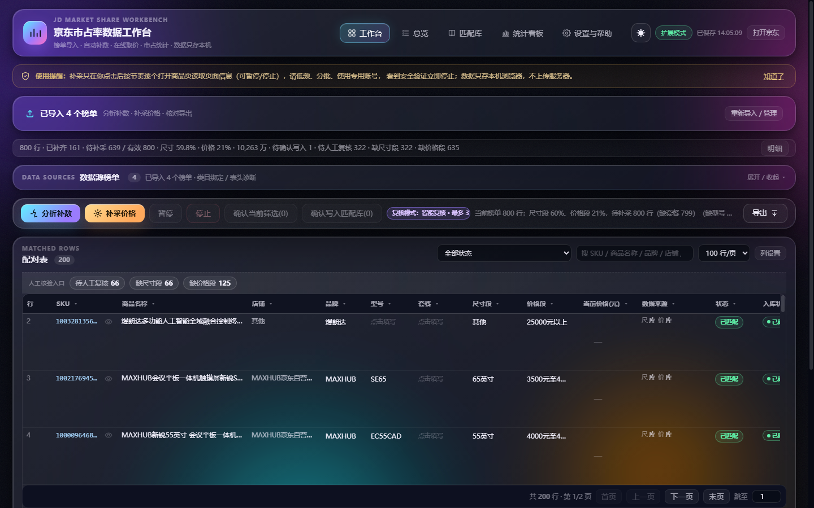
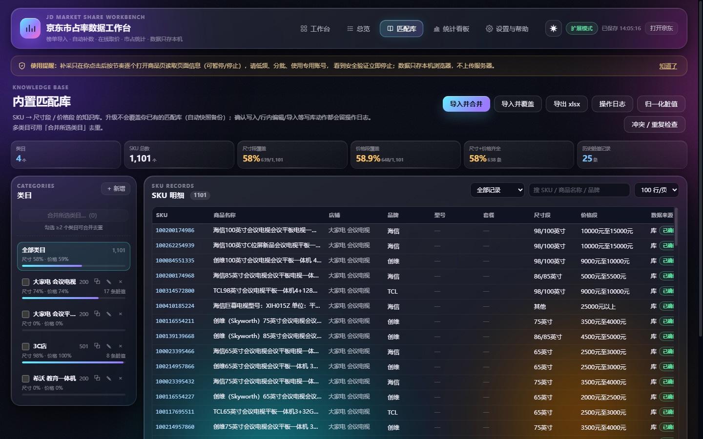
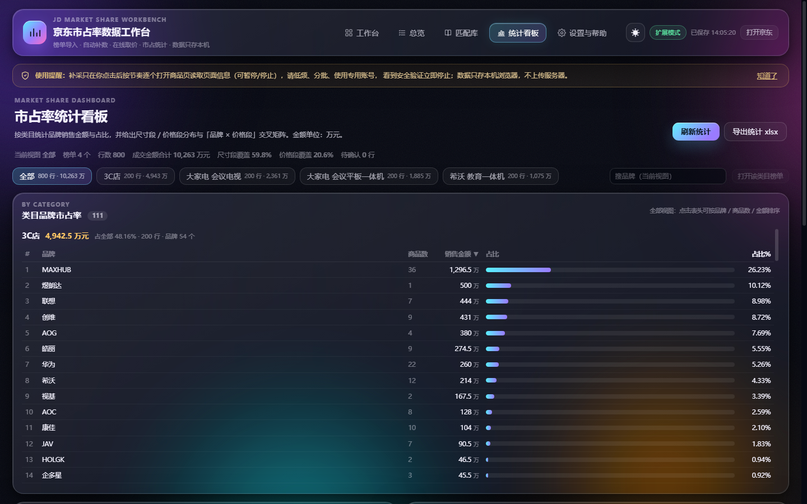

# 电商平台市占率数据工作台 · 使用说明

> 适用版本：v2.1.7（Edge / Chromium MV3 扩展；2026-11-05 更新：**价格采集算法移植自巡检双轨版**（锁定价格区/排除比价卡/字号最大/3 轮稳定+4×1.2s 复核/priceChanges/候选 JSON）· 价格类型徽标 · 数据来源 `页面采集(到手价/PLUS价/电商平台价)` · 下架不计进度分母 · v2.1.6 价格只来自库/页面 · 尺寸严格空置 · 快速人工定位）
> 面向：负责月度店铺市占率数据整理的同事、维护匹配库的同事。
> 快速开始请先看仓库根目录的 [README.md](../README.md)；本文是更细的操作手册。

---

## 目录

1. [这个工具做什么](#一这个工具做什么)
2. [安装与打开](#二安装与打开)
3. [工作台页（导入 → 分析 → 补采 → 核对 → 导出）](#三工作台页)
4. [匹配库页（知识库维护）](#四匹配库页)
5. [统计看板页](#五统计看板页)
6. [设置与帮助页](#六设置与帮助页)
7. [字段/关键列/多采样复核与状态机](#七字段含义与状态机)
8. [导出文件说明](#八导出文件说明)
9. [数据存储、备份与换机](#九数据存储备份与换机)
10. [常见问题排查](#十常见问题排查)
11. [合规与风控](#十一合规与风控)
12. [附：一次完整月度处理示例](#附一次完整月度处理示例)

---

## 一、这个工具做什么

平台每月会导出商品榜单 Excel（`.xlsx`）。榜单里只有成交金额、商品名、SKU、店铺等原始信息，要做市占率分析，还缺两列：**尺寸段**、**价格段**。

本工具把「查表 + 补数 + 统计 + 回填」串成一条流水线：

```text
导入榜单 xlsx
   ↓ 自动识别数据 sheet / 表头 / 绑定类目（含店铺/型号/套餐列）
分析补数（离线，秒级）
   ↓ 匹配库该 SKU 命中 → 页面采集（需先补采）→ 名称严格解析尺寸
  （价格只来自库/页面，绝不由名称/同名商品推断）
补采价格（在线，5–10 秒/个（v2.1.4 降频默认），可暂停）
   ↓ 后台打开 item.shop.example.com 商品页，只读页面价格/尺寸/型号/套餐
   ↓ 多采样复核：只核对一致性，拿不准标「需确认」
人工核对（表格行内改，自动写回匹配库；需确认行逐条/批量确认）
   ↓
导出：回填榜单 xlsx（20/23 列）+ 市占率结果 xlsx + 匹配库 xlsx + 备份 JSON / CSV（工作台/总览/配对明细 15 列、匹配库 10 列，表头与界面一致）
```

数据只存在本机浏览器，**不经过任何服务器**。

---

## 二、安装与打开

### 2.1 安装（只需一次）

1. Edge 地址栏输入 `edge://extensions/` 回车；
2. 打开页面左下角「开发人员模式」；
3. 点「加载解压缩的扩展」，选择：
   `~/Desktop/市占率\extension`
4. 点工具栏的扩展图标 → 选择「固定」；
5. 之后点扩展图标即可打开整页工作台。

> 更新插件代码后：`edge://extensions/` → 该扩展卡片上的「重新加载」→ 回到工作台页面按 `Ctrl+F5` 刷新。
>
> ⚠️ **扩展目录不要移动、不要改名**：Edge 以绝对路径加载扩展，路径一变扩展 ID 就变，`chrome.storage.local` 里的匹配库/榜单会话/采集缓存就读不到了（看起来像“数据丢了”）。确实要搬目录时，先在「设置 → 导出备份 JSON」，移动并重新加载扩展后，再「导入备份 JSON」。
>
> 如果提示 `Cannot load extension with file or directory name _xxx`：扩展目录里不能有 `_` 开头的文件/文件夹（Edge 限制）。本工具的调试脚本都在仓库的 `tools/`、`tests/`、`dev-tools/`，不要拷进 `extension/`。

### 2.2 打开后的样子



- 顶部：扩展名、**五个页面导航（工作台 / 总览 / 匹配库 / 统计看板 / 设置与帮助）**、当前环境、保存状态、「打开电商平台」；
- 顶栏右侧 **☀/🌙 主题按钮（v2.1）**：一键切换白天/黑夜，默认跟随系统，切换后记住选择；
- 配对表 SKU 旁 **👁 小眼睛（v2.1.2）**：悬停约 0.6 秒预览商品页小窗、移开自动关、点击固定；非扩展环境不可用（详见 3.6）；
- 右上角环境标识：正常应显示「Edge 扩展环境」；若显示「预览模式」，说明 `chrome.storage` 不可用（通常是直接双击 html 打开），功能会降级，请从扩展图标进入；
- 合规提醒条：首次使用建议读一遍，点「知道了」收起。

> 浅色主题效果见 05-workbench-light.png（深色 4 张为交付主图，浅色按需切换）。

### 2.3 首次打开会自动导入匹配库

首次打开工作台，会把内置匹配库种子（`extension/data/base-skus.json`）导入到本机存储：

- 4 个类目：`大家电 会议电视`、`大家电 会议平板一体机`、`3C店`、`品牌A 教育一体机`；
- 共 **1101 个 SKU**，其中 **638 条**尺寸段+价格段齐全（v2.1.4 用权威版 `资料/匹配库.xlsx` 重建；会议电视 200/148、会议平板 200、3C店 501/490、教育 200）。

想确认：打开「匹配库」页 → 顶部 KPI 应显示 4 个类目 / 1101 个 SKU（**638 齐全**）。

---

## 三、工作台页

工作台是主流程页面，从上到下依次是：导入区 → KPI → 数据源榜单卡片 → 操作栏 → 采集进度（采集时显示）→ 配对表。

### 3.1 导入榜单

1. 点「导入榜单 xlsx」（或把 `.xlsx` 文件直接拖进页面），支持一次多选；
2. 程序会：
   - 自动遍历工作表挑出**数据页**（跳过「尺寸段和价格段」这类说明页）；
   - 自动识别表头行与各列（`SKU ID` / `SPU ID` / `sku` / `商品编号`、`商品名称`、`品牌`、`成交金额`、`店铺`/`店铺名称`、`尺寸段`、`价格段`、**`型号`**、**`套餐`**（v2.1）等）；
   - 按 SKU 重合度 + 文件名关键词，自动建议绑定到匹配库的某个类目。
3. 导入完成后，每张榜单卡片显示：文件名、识别到的工作表、表头置信度、行数、绑定类目。**绑定不对时用卡片上的下拉框改绑**（绑定影响库命中优先级，但 SKU 在全局库里的命中不受影响）。
4. 识别不准（例如提示「没有识别到 SKU 列」）时，点「表头诊断」：
   - 弹窗展示前 10 行的预览；
   - 在「列映射」里逐个指定 SKU / 商品名称 / 品牌 / 成交金额 / 店铺 / 尺寸段 / 价格段（v2.1 还会识别 型号/套餐 列，识别不到的留空即可）；
   - 点「保存映射并重新识别」→ 映射按**文件名**记住，下次同文件名自动套用（可在设置页清空）。

### 3.2 分析补数（离线）

点「分析补数」，程序按优先级给每行补尺寸段 / 价格段 / 型号 / 套餐 / 店铺：

| 优先级 | 来源 | 规则 |
|---|---|---|
| 1 | **库** | 匹配库中同 SKU 有值（先做脏值归一） |
| 2 | ~~名称推断~~（v2.1.6 已删除） | 同名商品不再补任何字段；价格/尺寸都不允许跨行推断 |
| 3 | **名称严格解析（尺寸，v2.1.6）** | 只认「明确尺寸表达」（数字+英寸/寸/吋）：名称里恰好 1 个 → 识别；**≥2 个（含 98/100、86/85、55/65）→ 一律留空+待人工复核**；型号数字（75MBK7）不当尺寸；名称不产价格 |
| 4 | 待办 | 仍缺 → 标「待采集」（缺价格段）/「待补」（缺尺寸段） |

- 型号/套餐为空是正常的（商品名里没有型号、页面规格也没写），**不阻断流程**；可在行内手动补，补过的会写回匹配库。
- 店铺列：榜单有「店铺/店铺名称」列时直接用；没有时用报告绑定的类目名兜底并在来源里标注。

分析是纯离线计算，几秒完成，不访问网络。

### 3.3 补采价格（在线）

补采前请确认：**已在同一个 Edge 登录电商平台账号**。

> **首次使用建议**：先把「每次最多采集」设成 **5~10** 跑一小批，核对采到的价格/尺寸与电商平台页面一致后，再放开（设 0 = 不限制）全量跑。

1. 点「补采价格」→ 弹出确认（待采 SKU 数、预计耗时）→ 开始；
2. 工作台在**后台标签页**逐个打开 `https://item.shop.example.com/<sku>.html`，只读页面上已渲染的价格、标题、规格尺寸、型号/套餐；
3. 节奏默认 **5–10 秒/个（随机；v2.1.4 默认降频）**，可在设置里改；可随时「暂停 / 继续 / 停止」；
4. **连续 3 个失败**或识别到安全验证 → 自动暂停并提示；
5. 采到的价格会按设置里的「采价优先级」（到手价 → 电商平台价 → PLUS 价）取值，换算成价格段；标题/规格里的英寸换算成尺寸段；商品页规格参数里的型号/套餐优先于商品名解析；
6. 只采失败项/部分项时，可用筛选「待补采」「采集失败」后只对当前结果重采；单行也可以点「重采」。

#### 3.3.1 多采样复核（v2.1）

竞品数据没有标准答案，页面价会随账号/券/地区/时间波动。工具的做法是「同一个 SKU 多看几次，只核对一致性，拿不准交人工」，**不判断价格高低、不拿任何参考值改结果**：

| 采集模式（设置页） | 行为 | 适用 |
|---|---|---|
| **智能复核**（默认） | 先采 1 次；遇到疑点自动再采，最多 `maxSamples` 次（默认 3） | 日常 |
| **固定双采** | 固定采 2 次，差值超容差可再补到 `maxSamples` | 价格段敏感月份 |
| **单次采集** | 只采 1 次（旧行为） | 快速跑量 |

- **会触发再采/标需确认的信号**（纯规则，不涉及价格高低对错）：
  1. 价格**靠近价格段边界**（默认距边界 `max(10 元, 价格×1%)` 以内，可调）；
  2. 多次采样**落在不同价格段**；
  3. 多次采样**价差超出容差**（默认 `max(30 元, 价格×1%)` 以内算一致，可调）；
  4. 价格明显偏离「同店铺+同尺寸段」匹配库参考区间（库样本 ≥5 才启用）；
  5. 与匹配库已有价格段不一致；
  6. 取价证据弱（候选不足 2 个 / 口径未知 / 文本兜底）。
- **选值**：一致或不一致都取**中位数**（偶数取中间均值），绝不向库值或任何参考值靠拢；
- **日志**：每条会显示「第 2 次复核」「2 次一致 median=¥X」「价差 ¥X 标需确认」等；
- **状态**：命中信号的行标「**需确认**」；不命中的正常行直接「已补采」。

采集耗时参考：约 600 个 SKU × 5–10 秒 ≈ 50–100 分钟；开启多采样复核后，有疑点的 SKU 会多采 1–2 次，耗时相应增加（通常只占少数行）。支持分批（设置「每次最多采集」）与断点续采（采集缓存已存本机）。

### 3.4 人工核对与修正

- 点行内「打开」在新标签打开商品页人工核对；
- **尺寸段 / 价格段 / 型号 / 套餐行内编辑**：点击单元格里的值 → 下拉选规范值，或直接输入自定义值 → 自动保存，并**写回匹配库**（来源记为「手动」）；
- **品牌**同样可行内编辑（补齐品牌链路漏掉的行）；
- **需确认行（v2.1）**：状态列显示「需确认」，操作列多一个「确认」按钮；点「确认」后状态回「已补采」，并记录「✓ 已人工确认（时间）」。筛选出所有需确认行后，可点工具条「**确认当前筛选(N)**」一次全部确认（会弹确认框，可取消）；
- 状态 / 数据来源列会随修改自动更新；
- 筛选：全部 / 已补齐 / 待补采（缺价格段）/ 待补尺寸（缺尺寸段）/ **需确认（多采样有疑点）** / 采集失败；
- 搜索：SKU / 商品名称 / 品牌；
- 每页行数：50 / 100 / 200。

### 3.5 KPI 与导出

顶部 KPI：文件数、总行数、尺寸段覆盖、价格段覆盖、待采集、采集失败、**待确认（v2.1，可点击筛选）**、总成交金额（万元）。

- KPI 卡片可点击切换筛选：**已补齐 / 待补采 / 采集失败 / 需确认**，再点一次取消回全部；
- 「待确认」KPI 显示当前全部榜单里需人工确认的行数，点击后表格只显示这些行（与状态筛选联动）。

「导出」菜单（v2.1 列说明见 8.1/8.2）：

| 菜单项 | 生成文件 | 用途 |
|---|---|---|
| 导出当前榜单回填 xlsx | `回填_<原文件名>_<时间戳>.xlsx` | 当前选中榜单：原榜单全部列 + 尺寸段/价格段/型号/套餐（原表已有则原地填）+ 数据来源 + 复核状态 |
| 导出全部榜单回填 xlsx（推荐） | 每个榜单各一个 `回填_<原文件名>_<时间戳>.xlsx` | 一次导出全部榜单；文件之间自动间隔，Edge 首次会询问「允许下载多个文件」，点允许即可 |
| 导出市占率结果 xlsx | `市占率结果_<时间戳>.xlsx` | 统计_类目 / 统计_尺寸段 / 统计_价格段 / 配对_1..n；**有待确认行时在统计页后插入「待确认」sheet** |
| 导出备份 JSON | `市占率备份_<时间戳>.json` | 匹配库 + 榜单会话 + 采集缓存，可换机恢复 |
| 导出当前榜单筛选 CSV | `配对明细_<日期>.csv` | 当前筛选/搜索结果的明细（Excel 可直接打开） |

### 3.6 小眼睛预览商品页（v2.1.2）

配对表每一行 SKU 文本右侧有一个**小眼睛按钮 👁**（鼠标移到行上可见）。它的作用是：**不用反复「打开→关标签页」，悬停就能在商品页小窗里确认这个 SKU 长什么样、卖什么价**。

| 操作 | 行为 |
|---|---|
| 鼠标悬停在 👁 上 | 停留约 **0.6 秒** → 打开 `https://item.shop.example.com/<SKU>.html` 的**小窗（popup）**，窗口**不抢当前窗口焦点**，可继续在表格里核对数据 |
| 鼠标移开 | 若还没弹出则取消打开；若已弹出且未固定 → 约 **0.5 秒**后自动关闭（留出把鼠标移进小窗的时间） |
| 点击 👁（未打开） | 打开预览并**固定**（窗口获得焦点，鼠标移开不关） |
| 点击 👁（已打开同一 SKU、未固定） | 转为固定并聚焦 |
| 点击 👁（已固定） | 关闭预览 |
| 悬停到另一行 | 关闭旧预览、打开新行预览（同一时间只保留 1 个预览窗口） |
| 切到其它页面 / 开始补采 / 关闭工作台 | 自动关闭预览窗口 |

- **窗口位置**：优先放在工作台窗口**右侧**（不遮挡表格），右侧放不下放左侧、再不行居中，并按屏幕边界收进可视区域；大小约 1100×820（按屏幕可用区域自适应）。
- **与「打开」按钮的区别**：
  - 「打开」= 在**新标签页**长期打开商品页，适合仔细查看/对比多个商品；
  - 小眼睛 = **临时小窗**，适合快速扫一眼，移开即关，不占标签页。
- **注意事项**：
  - 预览窗口加载的是**真实电商平台商品页**，需要登录态；页面慢/未登录/无网络时窗口内是电商平台自己的加载/登录/错误页，工具不做额外处理，可改用「打开」在新标签页查看；
  - **预览也会访问电商平台商品页**，请按需使用、不要高频来回悬停（与补采相同的低频原则）；遇到安全验证立即停止；
  - 非扩展环境（直接打开 html 预览）没有 `chrome.windows`，小眼睛会隐藏或点击提示「预览需要在插件内使用」。

### 3.7 配对总览页（v2.1.3）

导航第 5 页「**总览**」= 全部榜单的全部配对行（800 行）汇总表，适合批量核对/修改；工作台仍保留「当前榜单」视图。

1. 顶部工具条：**店铺筛选**（全部 + 4 个绑定类目）、状态筛选（6 态）、搜索（SKU/名称/品牌/店铺/型号）、每页（200/500/全部）、导出当前筛选 xlsx / CSV；
2. 表格 15 列：`行 | SKU（带小眼睛）| 商品名称 | 店铺 | 品牌 | 型号 | 套餐 | 尺寸段 | 价格段 | 当前价格(元) | 成交金额(万元) | 采样 | 数据来源 | 状态 | 操作`；
3. **行内编辑**：点 品牌/型号/套餐/尺寸段/价格段 → 输入或选规范值 → 保存：
   - 该行字段与来源更新为「手动」，状态/复核显示刷新；
   - **写回匹配库**（同 SKU 多行同步），下次分析直接命中；
   - 自动持久化 + toast「已写入匹配库（SKU …）」；
   - 尺寸段/价格段填非规范值 → 红框提示并拒绝（不改库、不写行）；
4. 表头可点排序（行号/成交金额/当前价格/尺寸段/价格段）；
5. 「打开」= 新标签页看商品页；小眼睛 = 悬停预览（同 3.6）；「确认」用于需确认行。

### 3.8 当前价格列与套餐口径（v2.1.3）

- **当前价格(元)**：采集到的当前页面价（多采样取中位数，单位元）。工作台配对表、总览页、回填/结果 xlsx、CSV 都输出该列；未采集显示 `—`。人工审核只需对照「当前价格」与商品页价格（价格段由脚本匹配）。
- **套餐口径（纠正）**：套餐 = 商品页「版本/套餐」选择区**已选中的选项**（例如 `会议大屏+摄像头【免费送装一体】`），**不是**标题里的内存规格（`4+64GB`）。优先级：榜单「套餐/套装/版本」列（离线）→ 商品页已选版本（采集覆盖）→ 手工填写；标题猜测已弃用，识别不到留空。
- **旧数据升级**：升级 v2.1.3 首次打开会清理旧版「标题推测套餐」（来源 名称/标题/名称解析 的行），来源 榜单列/页面采集/手动 的套餐保留；清理条数会提示，建议升级前导出备份 JSON。v2.1.6 起不再从名称推断价格/尺寸（历史数据按库/列/页面值保留）。

### 3.9 匹配库核验与「确认写入匹配库」（v2.1.4）

> 目的：防止脚本/AI 自动补齐的、未经人工核验的数据污染匹配库。

**行级「入库状态」四色**（工作台/总览新增列、行底色、左上色条、徽标）：

| 状态 | 条件 | 颜色 | 徽标 |
|---|---|---|---|
| 已确认 | 库记录已人工确认，且有尺寸段+价格段 | 正常 | 已确认 |
| 库数据不全 | 库里有记录，但未核验或缺尺寸段/价格段 | 浅黄 | 库数据不全 |
| 新 SKU | 匹配库里没有这个 SKU | 橙色 | 新 SKU |
| 待确认写入 | 自动补齐后尚未确认写库（**非 verified 且已有尺寸段+价格段**） | 蓝色 | 待确认写入 |

- 状态筛选新增「新 SKU / 库数据不全 / 待确认写入」；KPI 新增「待确认写入 N」；
- **写库只有两个入口**：① 行内手动改（视为人工核验，写 verified=true/origin=manual）；② 点「确认写入匹配库」（单行或工具栏批量，写 origin=confirm）；**分析与采集自身永不写库**；
- 确认前校验：尺寸段/价格段必须合法且齐全，否则拒绝并提示；
- 确认后该行变「**已确认**」（v2.1.5 文案，旧「已入库」作废），行内按钮变「已确认」并禁用，匹配库对应记录徽标「已确认」、数据来源 `已确认（人工/人工确认/种子/导入）`；`settings.ui.confirmedWrites` 累加；
- 未采集时 pending 是 1 行（v2.1.6 口径：名称/库/列补齐不算「待确认写入」，只有采集类自动补齐才标 pending；libStates 160/192/447/1）；采集补齐的新行也会进入 pending，确认后才入库。

### 3.10 被电商平台频控怎么办（v2.1.4）

1. **识别**：采集落地页变成电商平台首页（`www.shop.example.com`/`home.shop.example.com`）、登录页或安全验证页（含「安全验证/访问频繁/请验证」）→ 工具判定为风控；
2. **自动处理**：立即暂停补采 + 冷却 **60 分钟**（设置可调），进度面板显示倒计时；冷却期内「开始补采」被禁用；顶部出现风控横幅（可关闭）；
3. **降低触发概率**：默认间隔 5~10s、每批上限默认 20（**v2.1.5 起设置 5~100 可调并实际生效**）、每 8 条长休息 30~60s、复用单标签页；建议把每批降到 ≤10、间隔 ≥10s；
4. **人工预览通道**：被频控时用**小眼睛**打开商品页小窗（人工逐条、低频），加载后自动显示「预览读数：SKU · 到手价 · 尺寸 · 套餐 [采用] [忽略]」；点「采用」→ 写入当前行（仍为待确认写入，需再确认入库）；点「忽略」→ 丢弃本次读数；
5. **建议**：停 24 小时再采；换电商平台账号/网络（手机热点/家宽）；不要连续重试；优先人工预览核对少量关键行。

### 3.11 表格列显隐 / 表头筛选 / 列悬停（v2.1.5）

- **列设置**：配对表/总览工具条「列设置」→ 勾选显示隐藏列（行、SKU 必选；其它列可选），选择记住，刷新后保持；也可切换行高；
- **表头筛选**：每个表头右侧筛选按钮 → 值多选（带搜索）/ 当前价格可填数值区间 / 清空；支持多列同时筛选（AND），与状态筛选/搜索叠加；生效后表头显示筛选标记；
- **列悬停高亮**：鼠标在任一列上，整列高亮，方便横向对照（深浅主题都有）。

### 3.12 异常自动继续：下架跳过、软异常等 60 秒（v2.1.5）

| 情况 | 行为 |
|---|---|
| 商品下架/不存在 | 该行标「已下架」，**跳过继续下一条**，不暂停、不算风控 |
| 跳电商平台首页/空页/跳转异常（无验证特征） | **等待 60 秒自动继续**（可设置 `anomalyWaitSec`，0=立即）；界面倒计时，可「立即继续」或「停止」 |
| 安全验证/登录页/验证码 | 冷却 60 分钟 + 暂停（同 3.10），提示换账号/网络 |

> 连续异常 ≥3 次仍未恢复时，工具会升级为冷却暂停并提示；不需要你手动重启。

### 3.13 匹配库保护、操作日志与类目合并（v2.1.5）

- **升级不覆盖**：升级时默认「只补缺失 SKU」（merge-missing），你库里已有记录、改过的尺寸/价格/型号/套餐完全不动；只有你主动点「重置内置库」才会整体替换；
- **备份**：首次写库前自动快照 `libraryBackup_v215`；设置页显示备份时间并支持「从备份恢复」；
- **操作日志**：匹配库页「操作日志」→ 查看 确认写入/手动编辑/导入/归一化/种子迁移/类目合并/去重（时间、类型、类目、SKU、字段、原值→新值、来源）；最多保留 **500 条**，可按 SKU/类目/类型搜索并导出 CSV；
- **类目合并去重**：类目面板多选 →「合并所选类目…」→ 选目标类目（可新建）→「预览」（合并前条数、去重后、重复数、字段冲突明细）→「执行合并」；按 SKU 归一化去重（忽略空格/大小写），冲突按 已确认 → 更新时间新→旧 → 字段完整度 取值；单个类目也可「去重」；合并前自动快照，可恢复。

---

### 3.14 快速人工定位：待人工复核 / 缺尺寸段 / 缺价格段（v2.1.6）

- 工作台/总览工具条三个快捷 chip（带实时计数）：**待人工复核 N**（名称多尺寸/无明确尺寸）、**缺尺寸段 N**、**缺价格段 N**；点一下筛选、再点取消，可与状态筛选/搜索叠加；
- 行内：尺寸空格显示「待人工/缺」+ 原因提示；待复核行状态列标「待复核」；导出「状态」列同样体现（列结构不变）；
- 用法：先点「待人工复核」逐条补齐规范尺寸段；再按「缺价格段」定位，用页面采集/人工补价；不用全量点开商品页。

### 3.15 价格与尺寸硬规则（v2.1.6，务必了解）

**价格绝不能由名称判断，只有两个合法来源：**

1. **匹配库中该 SKU 的记录**（人工/权威维护，可信）；
2. **页面采集价格**（到手价/电商平台价 → 价格段）；

名称里的金额、同名商品、标题数字都不产价格（旧「名称推断」已彻底删除，数据来源不出现该词）。库无记录 → 价格空、状态「缺价格段」，用快捷筛选定位后在线采集。新基准：价格段 **165/800（20.6%，全部来自库）**、待补采 **635**。

**尺寸严格识别：** 匹配库该 SKU → 名称严格解析 → 页面采集（规格参数优先）→ 空置等人工；

- 名称出现 **≥2 个尺寸表达**（`55/65`、`98/100`、`86/85`、`75英寸 86英寸` 等）→ **一律空置**，标「待人工复核」，不再做同段归一；
- 型号数字（`75MBK7`、`VH75CAD`）和无单位数字（`5000元`、`4K`）不当尺寸；无明确尺寸同样留空待人工；
- 单值（`65英寸`/`75寸`/`85吋`）才自动识别；采集到页面明确尺寸后会清除待复核标记。新基准：尺寸段 **478/800（59.75%）**、sizeAmbiguous **322 行**（多值 248 + 无明确 74）。

### 3.16 价格采集算法（移植自巡检双轨版，v2.1.7）

本版商品页取价整体改用「巡检插件-双轨版」v2.1 的算法（实测错误率最低），规则：

1. **锁定当前商品价格区**：不在全页聚合价格，候选需「可见 + 首屏内（优先）+ 文本是完整价格」，最后按**字号最大**选价（到手价=大号红字，电商平台价=旁边小号灰字）；
2. **排除无关价格卡**：跨平台比价卡、关联购买、推荐/相似/猜你喜欢、广告/横幅、店铺卡、促销卡、足迹等容器价格全部跳过（旧逻辑 76% 的会员价错读自这些卡片）；
3. **只认可见元素**：隐藏/无布局尺寸/抽屉内价格跳过；**严格完整价格**（拒绝「56」片段、折扣/分期/满减/月供/评价/销量等），价格 ≥30 元；
4. **口径**：PLUS/会员 → PLUS价；到手价/券后 → 到手价；电商平台价/原价/划线价 → 电商平台价；无标签按字号判断；被划线算电商平台价；
5. **稳定性**：连续 3 轮（约 1.5s）读到同一价格才算稳定（最长 20s），稳定后再复核最多 4 次×1.2s，以页面最终刷新价为准；价格变化记录 `priceChanges`（不按阈值挑值、不猜）；
6. **上报/展示**：当前价格旁显示价格类型徽标；数据来源显示 `页面采集(到手价)` / `页面采集(PLUS价)` / `页面采集(电商平台价)`；候选价格 JSON（价格/字号/class/位置/变化）可在行内「调试」查看并复制。

> **不采纳的三项（原因）**：① **官方价 API 桥**（巡检 app 的 SP-API `price-stars`）只覆盖授权店铺**自有商品**普惠价，竞品 SKU 无法取数；② **AI 复核**需 AI Key，后续可选（只校验不覆盖）；③ **双轨/前台小窗**：竞品批量采集用后台标签页即可，频控严重时再评估。

### 3.17 下架不计入进度分母（v2.1.7）

- 采集时命中「已下架」的行标记 `offSale`，**不计入进度分母**；KPI 显示「待补采 X / 有效 Y（已下架 Z 不计入）」，总览状态筛选可单独筛「已下架」；
- 下架行仍保留在榜单/统计中（成交金额等口径不变），只是不算「待采集」；导出列结构不变。

### 3.18 采集调试：候选价格 JSON（v2.1.7）

- 行内「调试」→ 弹出本次取价的候选 JSON：前 12 条候选（`price/kind/text/cls/font/strike/rect`）+ `priceChanges` + 最终 `priceKind/priceRect`，可一键复制；
- 排查：先看当前价格旁的类型徽标；再看字号最大候选是否页面大号红字；若混入比价卡价格（8499/1999）或「56」片段，把 JSON 发开发（页面结构可能改版）；
- 价格刷新（如 24699→25099）会记入 `priceChanges`，以最终复核价为准。

## 四、匹配库页

匹配库 = 「SKU → 尺寸段 / 价格段」的知识库，是自动补数的基础。**本次补齐的映射会自动写回这里，越用越快。**



### 4.1 类目与 SKU

- 左侧：类目列表（可新增/改名）；
- 右侧：该类目的 SKU 明细表，可按「齐全 / 缺价格段 / 缺尺寸段 / 脏值」筛选，可搜索 SKU/名称/品牌；
- 顶部 KPI：类目数、SKU 数、齐全数、覆盖率（v2.1.4 新内置库：**1101 SKU / 638 齐全**）；
- 记录带「**已确认 / 待确认**」徽标（v2.1.5 文案）：已确认=种子/导入/人工确认；待确认=自动写入未确认；不影响列表 11 列的表头顺序。

### 4.2 导入 / 导出

- **导入并合并**：选择匹配库 xlsx（含多个 sheet，按表头识别列）→ 同名类目逐 SKU 合并，导入的非空字段覆盖旧值；
- **导入并覆盖**：清空现有类目后整体替换（首次建立内部库、或确认外部 Excel 是完整版本时用）；
- **导出 xlsx**：生成 `匹配库_<时间戳>.xlsx`，用于备份、交接或给其他同事导入；
- 支持导入的匹配库格式与内置种子一致（`SKU（商品编码）`/`商品名称`/`品牌`/`尺寸段`/`价格段` 表头；列顺序可不同）。

### 4.3 清洗与检查

- **归一化脏值**：把「其他（50英寸）」「其他尺寸(120英寸）」「3000元3500元」「25000以上」「未识别」等历史脏值统一成规范值，执行后在「检查结果」里列出 before → after 明细；
- **冲突 / 重复检查**：统计缺尺寸段/缺价格段/脏值/跨类目同 SKU 值冲突/空商品名的记录，逐条列出便于人工处理。

---

## 五、统计看板页



- **类目选择条（v2.1）**：顶部一排 `全部` + 每个已绑定类目的 tab（显示 `类目名 · 行数 · 金额`，有待确认行时还会显示「待确认 N」）：
  - 点单个类目 → 「类目品牌市占率」只渲染该类目的品牌表（全宽，不再 4 个类目纵向堆叠），尺寸段分布 / 价格段分布 / 品牌×价格段矩阵都按该类目过滤；
  - 点「全部」→ 回到汇总视图（各类目汇总 + 类目合计）；
  - 「打开该类目榜单」按钮：切回工作台并把该类目的榜单设为当前榜单（未选类目时禁用）。
- **类目品牌市占率**：按类目列出品牌、商品数、成交金额（万元）、品牌占比（%），并带类目合计行；
- **尺寸段分布 / 价格段分布**：各段的商品数、成交金额、占比（纯 SVG 柱状图）；
- **品牌 × 价格段 交叉矩阵**：颜色越深表示该品牌在该价格段的成交金额越高；
- **刷新统计**：修改数据后点一次；
- **导出统计 xlsx**：等价于工作台的「市占率结果 xlsx」。

统计口径：

- 类目总额 = 各行成交金额中值之和（金额异常行记 0，并在明细标「金额异常」）；
- 品牌占比合计 = 100%（品牌为空归「未标注品牌」）；
- 尺寸段包含 `其他尺寸(n英寸)` 这类动态值（不丢行）；
- 「需确认」行仍计入统计（价格段已按中位数给出），全部确认只是解除人工疑点标记，不改变数值。

---

## 六、设置与帮助页


修改后点「保存设置」生效（影响下一次分析与补采）；「恢复默认」可还原。

| 分组 | 设置项 | 说明 |
|---|---|---|
| 采集节奏 | 每次最多采集 | 0 = 全部；**首次建议先设 5~10 小批量验证** |
| | 每个页面间隔（秒） | 默认 5–10 秒随机（v2.1.4）；请勿调到过低 |
| | 单条失败重试 | 默认 1 次 |
| | 跳过今天已采过的 SKU | 默认开，方便分批续跑 |
| | 采集结束保留后台标签页 | 调试用，平时关 |
| 多采样复核（v2.1） | 采集模式 | 智能复核（默认，按疑点自动补采）/ 固定双采 / 单次采集 |
| | 最多采样次数 | 2~5，默认 3；智能复核/固定双采的上限 |
| | 两次采样容差 | 判「一致」的价差上限，默认 `max(30 元, 价格×1%)` |
| | 边界敏感带 | 距价格段边界多近算「靠近边界」，默认 `max(10 元, 价格×1%)` |
| 价格口径 | 采价优先级 | 三档下拉：到手价 / 电商平台价 / PLUS 价，可调顺序 |
| | 价格段边界口径 | 左闭右开 `[low, high)`（默认）/ 左开右闭 `(low, high]` |
| | 合理价下限（元） | 默认 30，低于该值的数字片段不当作价格 |
| 界面（v2.1） | 主题 | 跟随系统（默认）/ 白天 / 黑夜；与顶栏 ☀/🌙 联动 |
| 表头映射记忆 | 查看 / 清空 | 手动诊断过的列映射按文件名保存 |
| 数据备份与清理 | 导出 / 导入备份 JSON | 换电脑迁移；导入后覆盖本机数据 |
| | 清空采集缓存 | 不影响匹配库 |
| | 清空榜单会话 | 清空已导入榜单与分析结果 |
| 调试 | 复制调试 JSON | 最近一次采集的原始候选价格（页面改版排查用） |
| 模块状态 | 重新检测 | 7 个 lib 模块加载状态（全部正常才启用导入/分析/导出） |

「使用说明（7 步）」在设置页底部，是随插件走的速查版。

---

## 七、字段含义与状态机

### 7.1 配对表字段

| 列 | 说明 |
|---|---|
| 行 | 原榜单中的行号 |
| SKU | 统一为**文本**（去空格、去尾部 `.0`、保留前导零、不用科学计数法） |
| 商品名称 | 原榜单商品名称 |
| **店铺**（v2.1） | 榜单「店铺/店铺名称」列；无该列时用报告绑定类目名兜底并在来源标注 |
| 品牌 | 补全后的品牌（来源见「数据来源」中的品牌来源） |
| **型号**（v2.1） | 榜单「型号」列 → 商品名型号 token → 商品页规格参数（权威值）；识别不到留空 |
| **套餐**（v2.1.3） | 榜单「套餐/套装/版本」列 → 商品页「版本/套餐」**已选中的选项**（如 `会议大屏+摄像头【免费送装一体】`）→ 手工填写；标题内存规格猜测已弃用；识别不到留空 |
| 尺寸段 | 规范尺寸段（可编辑） |
| 价格段 | 规范价格段（可编辑） |
| **当前价格(元)**（v2.1.3） | 采集到的页面价（多采样中位数，元）；未采集显示 `—` |
| **入库状态**（v2.1.5） | 已确认 / 库数据不全 / 新 SKU / 待确认写入（见 3.9；颜色与徽标同界面一致） |
| 成交金额（万元） | 榜单金额区间中值（元/万元混排自动换算） |
| 采样（v2.1） | 本行采了几次、价差多少（如「2 次（差 5 元）」） |
| 数据来源 | 尺寸段/价格段/型号/套餐/品牌的来源，如「尺寸段：库；价格段：页面采集」 |
| 复核状态（导出/待确认 sheet） | 「需确认：原因…」或「✓ 已人工确认（时间）」；无需复核时为空 |
| 状态 | 见下表 |
| 操作 | 打开商品页 / **👁 悬停预览（v2.1.2）** / 重采 / 编辑 / **确认（需确认行）** |

### 7.2 状态机

```text
分析后：
  尺寸段+价格段都有（库/列/页面采集）       → 已匹配
  只有尺寸段                              → 部分（缺价格段，可补采）
  只有价格段                              → 待补（缺尺寸段，人工补）
  两个都缺                                → 待采集
补采后：
  补齐且复核无异常                        → 已补采
  补齐但多次采样不一致/靠近边界等          → 需确认（v2.1）
      └─ 人工点「确认」（行内或确认当前筛选） → 已补采 + 记录确认时间
  页面取价失败（下架/风控/超时）           → 采集失败（可重采或手动改）
```

> 状态字符串以 `lib/rules.js` 的 `STATUS` 为准：已匹配 / 已补采 / 部分 / 待采集 / 待补 / 采集失败 / **需确认**。

### 7.3 数据来源取值

- 尺寸段 / 价格段（v2.1.6）：尺寸 `库`、`名称解析`（严格）、`列`、`页面采集`、`手动`；**价格只有 `库`、`列`、`页面采集`、`手动`（不会出现「名称推断」）**；
- 型号 / 套餐：`列`（榜单列）、`名称`、`库`、`页面采集`、`手动`（v2.1）；
- 品牌：`列`（榜单品牌列）、`库`（同 SKU 库）、`名称`（商品名识别）、`店铺`（店铺名识别）、空（显示「未标注品牌」）。

---

## 八、导出文件说明

### 8.1 `回填_<原文件名>_<时间戳>.xlsx`

- **保留原文件全部工作表、列顺序、行数**；
- 数据页列策略（v2.1.3）：`尺寸段`、`价格段`、`型号`、`套餐` 原表已有 → **原地填**；没有 → 在末尾**追加**；同时追加 `当前价格`、`数据来源`、`复核状态`（都去重，不重复同名列）；
  - 普通榜单：13 列 → **20 列**（+尺寸段+价格段+当前价格(元)+型号+套餐+数据来源+复核状态）；
  - 教育教学文件：20 列 → **23 列**（原表已有 型号/套餐/尺寸段/价格段，原地填；只追加 当前价格(元)+数据来源+复核状态）；
- `当前价格` 列 = 采集到的页面价（多采样中位数，元），无采集为空；
- `复核状态` 列：需确认行写「需确认：原因…」，已人工确认行写「✓ 已人工确认（时间）」，无需复核为空；
- 行号与原文件一致（表头行、空行位置保持），便于和原始榜单对照；
- 可直接用 Excel 打开；复杂格式（合并单元格、条件格式）会被归一化为普通值——这是已知限制。

### 8.2 `市占率结果_<时间戳>.xlsx`

| 工作表 | 内容 |
|---|---|
| `统计_类目` | 类目 × 品牌：商品数、成交金额（万元）、品牌占比（%），含类目合计行 |
| `统计_尺寸段` | 尺寸段：商品数、金额、占比 |
| `统计_价格段` | 价格段：商品数、金额、占比 |
| `待确认`（v2.1，仅当有需确认行） | 榜单/行号/SKU/商品名称/店铺/品牌/型号/尺寸段/价格段/**当前价格(元)**/采样/复核原因（12 列，插在统计页之后、配对页之前） |
| `配对_1..n` | 每个榜单一个 sheet，**15 列**（与界面表头逐字一致，不含「操作」）：`行、SKU、商品名称、店铺、品牌、型号、套餐、尺寸段、价格段、当前价格(元)、成交金额(万元)、采样、数据来源、状态、入库状态`；「行」= 榜单简称 #行号 |

> 没有需确认行时结果文件仍是 7 个 sheet（统计 3 + 配对 4）；有需确认行时 8 个。

表头加粗、首行冻结、列宽已设好。

### 8.3 `市占率备份_<时间戳>.json`

包含：匹配库（`ds.library.v1`）、榜单会话（`ds.session.v1`）、采集缓存（`ds.captures.v1`）与导出时间。换电脑时在设置页「导入备份 JSON」恢复。

### 8.4 `配对明细_<日期>.csv`

当前筛选/搜索结果的行明细，**15 列**（与工作台/总览表头逐字一致，不含「操作」）：行、SKU、商品名称、店铺、品牌、型号、套餐、尺寸段、价格段、当前价格(元)、成交金额(万元)、采样、数据来源、状态、入库状态；UTF-8 带 BOM（Excel 直接打开不乱码）。匹配库导出为 **10 列**：SKU、商品名称、店铺、品牌、型号、套餐、尺寸段、价格段、数据来源、更新时间。

---

## 九、数据存储、备份与换机

- 存储位置：`chrome.storage.local`（本机浏览器；申请了 `unlimitedStorage`）；
- **扩展目录不要移动、不要改名**：Edge 以绝对路径加载扩展，路径一变扩展 ID 就变，`chrome.storage.local` 里的数据就读不到了（看起来像“数据丢了”）；确实要搬时先导出备份 JSON，移动并重新加载后再导入；
- 键：`ds.library.v1`（匹配库）、`ds.session.v1`（本月榜单会话）、`ds.settings.v1`（设置）、`ds.captures.v1`（采集缓存）；
- **没有任何数据上传到服务器**，工具不调用电商平台接口，只读页面 DOM；
- **重新加载扩展 / 刷新页面不会覆盖已跑数据**：扩展目录路径不变 → 扩展 ID 不变 → `chrome.storage.local` 原样保留，页面打开自动恢复；升级 v2.1.3 首次打开只清理旧版「标题推测套餐」（来源 名称/标题/名称解析），其余数据保留，并把旧会话快照写入 `backup_v213` 键；
- **升级 v2.1.4**：内置匹配库自动替换为新版权威数据（1101 SKU/638 齐全），旧库中人工核验记录（manual/confirm）保留合并；`settings.ui.seedVersion` 记录种子版本；匹配库页数字从 1046 变 1101 属正常；
- 会丢数据的操作：移动/重命名 `extension/` 目录、移除扩展或在扩展详情里「清除数据」、浏览器清除站点数据、工具内「清空榜单/清空采集缓存」；
- 定期备份：建议每月处理完在设置页「导出备份 JSON」，存到本机/共享盘；
- 换电脑：旧机导出 → 新机安装扩展后「导入备份 JSON」；
- 清空：设置页可分别清空采集缓存 / 榜单会话；要连匹配库一起清，用 `edge://extensions/` 里的「清除数据」或卸载重装。

---

## 十、常见问题排查

| 现象 | 原因 / 处理 |
|---|---|
| 提示「没有识别到 SKU 列」 | 表头不常见：用「表头诊断」手动选列；保存后按文件名记住 |
| 数据 sheet 识别成说明页 | 正常文件会自动跳过说明页；若误选，在「表头诊断」里确认 sheet 和列，必要时把说明页删掉再导入 |
| 「数据引擎尚未就绪」/ 模块状态有加载失败 | `edge://extensions/` 重新加载扩展后刷新；确认 `extension/lib/` 下 7 个 js 都在；控制台（F12）看具体加载错误 |
| 补采一直超时/失败 | ① 确认已登录电商平台、能手动打开商品页；② 确认没被跳到登录/验证页；③ 减少每次采集数量先试跑；④ 提示安全验证时立即停止、降低频率 |
| 采到的价格是「5」或明显不对 | 已做稳定等待 + 数字片段过滤 + 30 元下限；仍异常的行会标「采集失败」而不是写错价。点「重采」或手动改；设置页「复制调试 JSON」可发开发排查 |
| 同一 SKU 多行 | 采集按 SKU 去重只采一次，多行共用结果；若其实是不同商品，回 Excel 修正 SKU 后重新导入 |
| 价格和我人工看的差一点 | 页面价受账号/券/地区影响，属正常；每行有采集时间与来源，可「改」手动修正 |
| 很多行标「需确认」（v2.1） | 多次采样不一致 / 靠近价格段边界 / 取价证据弱等；工具不替你下结论：筛「需确认」逐行核对，点行内「确认」，或「确认当前筛选(N)」批量确认；想少打扰可在设置里改「单次采集」 |
| 同一 SKU 两次采价不一样（v2.1） | 正常波动；工具取中位数并记录价差，差异大就标「需确认」，不会拿参考值改结果 |
| 型号/套餐列很多空（v2.1） | 商品名/页面规格里没有对应信息，识别不到就留空（不影响统计）；可在行内补，补过的写回匹配库 |
| 回填列数和以前不一样（v2.1.4） | 普通榜单 **20 列**、教育教学 **23 列**（原表已有的关键列原地填，不重复加；当前价格列表头改「当前价格(元)」）；详见 8.1 |
| 结果 xlsx 多一个「待确认」sheet（v2.1） | 有需确认行时自动生成，全部确认后再导出即回到 7 个 sheet |
| 统计只想看一个类目（v2.1） | 统计页顶部点类目 tab；点「全部」回汇总；「打开该类目榜单」跳回工作台 |
| 想切白天/黑夜（v2.1） | 顶栏 ☀/🌙，或「设置 → 界面 → 主题」；默认跟随系统，手动选后记住 |
| 小眼睛预览窗口空白/加载慢/显示验证页（v2.1.2） | 窗口内是真实电商平台页面：确认已登录、网络正常；慢时会看到电商平台自己的加载页；未登录/访问频繁可能被电商平台拦到验证页（`pc-frequent-pro.pf.shop.example.com`），退出重登或稍后重试；仍不行点「打开」在新标签页看；无外网/被风控时同样会空白 |
| 小眼睛悬停没反应/不弹窗（v2.1.2） | 需停留约 0.6 秒；确认在插件内页面（非直接双击 html）；提示「预览需要在插件内使用」时请从扩展图标进入工作台 |
| 预览窗口怎么固定/怎么关（v2.1.2） | 点一下小眼睛固定（再点关闭）；不固定时移开鼠标约 0.5 秒自动关；切页/开始补采也会自动关 |
| 预览窗口位置挡住表格/跑到屏幕外（v2.1.2） | 默认在表格右侧，放不下会放左侧/居中并按屏幕边界收进；多屏/缩放异常时会退化为默认位置，可拖动窗口标题栏自行调整 |
| 小眼睛预览会不会触发风控（v2.1.2） | 预览同样会访问电商平台商品页，请按需使用、不要高频来回悬停；遇到安全验证立即停止，与补采保持相同的低频原则 |
| 刷新页面/重新加载扩展后数据会不会没（v2.1.3） | 不会：数据在 `chrome.storage.local`，扩展目录不变则 ID 不变、原样恢复；只有移动/重命名 extension 目录、移除扩展/清站点数据、清空榜单才会丢 |
| 升级 v2.1.3 后套餐变空了（v2.1.3） | 预期行为：旧「标题猜测套餐」已弃用，升级时清理来源 名称/标题/名称解析 的套餐（榜单列/页面采集/手动保留）；补采后按商品页已选版本重新填充，也可手工补 |
| 行颜色/「入库状态」是什么意思（v2.1.5） | 橙=新 SKU（库里没有）、浅黄=库数据不全、蓝=待确认写入（自动补齐未确认）、正常=已确认；脚本不会自动写库，点「确认写入匹配库」才入库 |
| 点「确认写入匹配库」没反应/提示拒绝（v2.1.4） | 确认前会校验尺寸段/价格段必须合法且齐全；缺了会拒绝并提示，先补齐再确认。批量按钮只处理当前筛选内的「待确认写入」行 |
| 导出表头和界面不一致（v2.1.4 已修） | 已修复：工作台/总览/配对明细/CSV 15 列、匹配库 10 列，与界面表头逐字一致（界面「操作」列不导出） |
| 补采打开商品页变成电商平台商城首页/验证页（v2.1.4） | 电商平台频控。新版自动暂停+冷却 60 分钟+降频；冷却期禁止补采并显示风控横幅。建议停 24 小时、换账号/网络后再试；可用小眼睛预览人工核对 |
| 被频控时的「预览读数 [采用][忽略]」是什么（v2.1.4） | 小眼睛小窗加载后自动读取价格/尺寸/套餐；点「采用」写入当前行（待确认写入，需再确认入库），点「忽略」丢弃；人工逐条、低频，规避自动频控 |
| 升级后匹配库 SKU 数变了（v2.1.4） | 新版内置库用权威版 `资料/匹配库.xlsx` 重建：1101 SKU/638 齐全；旧人工核验记录保留；匹配库页可直接「导出 xlsx」备份 |
| 「当前价格(元)」为什么是 `—`（v2.1.3） | 该行还没补采；点「补采价格」后出现。当前价格 = 采集到的页面价（多采样中位数），人工审核对照它和商品页价格 |
| 回填 xlsx 变成 16 列了（v2.1.5） | 按用户要求改为界面同款 16 列（操作列留空、不保留原榜单列），每榜单 1 个 sheet；详见 8.1 |
| 每批上限设置生效吗（v2.1.5） | 生效：默认 20，可设 5~100，开始采集时按当前设置截断并显示「本批 N 条（上限 M）」；间隔/冷却/自动暂停同样下次采集生效 |
| 确认后为什么显示「已确认」（v2.1.5） | v2.1.5 文案统一：入库状态/按钮/匹配库徽标=已确认，数据来源=已确认（来源）；未确认仍为待确认写入/待确认 |
| 表格列太多能隐藏/筛选吗（v2.1.5） | 能：工具条「列设置」勾选显隐（记住选择）；表头右侧筛选按钮支持值多选/价格区间/清空；鼠标所在列整列高亮 |
| 补采跳到电商平台首页/下架会一直停吗（v2.1.5） | 不会：下架标「已下架」跳过；首页/空页等软异常等 60 秒自动继续（可立即继续/停止）；只有验证/登录等真风控才冷却暂停 |
| 升级会覆盖我改过的匹配库吗（v2.1.5） | 不会：默认 merge-missing 只补缺失 SKU、已有记录/改过的字段不动；首次写库前快照 libraryBackup_v215 可恢复；写库动作都有操作日志（≤500 条） |
| 多个类目重复了能合并吗（v2.1.5） | 能：类目多选→「合并所选类目…」→选目标→预览冲突→执行；按 SKU 归一化去重，冲突按 已确认→更新时间→完整度 取值，合并前自动快照可恢复 |
| 想一次看全部榜单的配对结果（v2.1.3） | 打开导航「总览」页：800 行全量、店铺/状态筛选、搜索、每页 200/500/全部；行内改 品牌/型号/套餐/尺寸段/价格段 会写回匹配库 |
| 匹配库表头变了/能在库里直接改吗（v2.1.3） | 匹配库表头已与工作台对齐（SKU/商品名称/店铺/品牌/型号/套餐/尺寸段/价格段/数据来源/更新时间/操作）；型号/套餐等可直接在库内点改并写回本库；店铺列显示匹配库类目归档 |
| 品牌显示「未标注品牌」 | 品牌链路（列/库/名称/店铺）都没识别出来，行内改品牌即可 |
| 改完的行下次还要改吗 | 不用，改动会写回匹配库；下月同 SKU 直接命中 |
| 导出的 xlsx 打不开 | 确认是浏览器下载的 `.xlsx` 且未改扩展名；被安全软件占用时先关掉再下 |
| 换电脑后数据没了 | 用备份 JSON 恢复；平时记得每月导出备份 |
| 误点了「导入并覆盖」 | 若之前导过备份，用备份 JSON 恢复；否则导入外部匹配库 Excel 重建 |

---

| 价格段能根据名称/标题自动出来吗（v2.1.6） | **不能**：价格只来自「匹配库该 SKU 记录」或「页面采集」，名称金额/同名商品一律不产价格；缺价格的行点「缺价格段」chip 定位后在线采集 |
| 名称有 98/100、86/85 为什么尺寸段空了（v2.1.6） | 用户硬规则：名称出现 ≥2 个尺寸表达一律不识别，留空+「待人工复核」；只有唯一明确尺寸（如 `65英寸`）才自动识别，型号数字不当尺寸 |
| 如何快速找到需要人工补的行（v2.1.6） | 工具条三个 chip：**待人工复核 / 缺尺寸段 / 缺价格段**（带计数），点一下即筛选；尺寸空格标「待人工」，状态列标「待复核」 |

| 价格采集算法换了吗（v2.1.7） | 换了：移植巡检双轨版 v2.1 取价——锁定当前商品价格区、排除比价/关联购买卡、只认可见完整价格、字号最大选价、3 轮稳定+4×1.2s 复核、记录 priceChanges 与候选 JSON；不按阈值挑值 |
| 为什么有「已下架」不计入待补采（v2.1.7） | 下架行不占进度分母：KPI「待补采 X / 有效 Y（已下架 Z 不计入）」；总览可筛已下架；数据仍保留在榜单/统计 |
| 采到的价格和页面不一致怎么办（v2.1.7） | 行内「调试」复制候选 JSON（价格/字号/class/位置/priceChanges），看最大字号候选是否页面大号红字；混入比价卡价格/56 片段就发 JSON 给开发 |

## 十一、合规与风控

- 只在**手动点击**后采集；只读页面 DOM，不调接口、不提交、不修改电商平台数据；
- **小眼睛预览（v2.1.2）** 同样会打开电商平台商品页：只在核对数据时按需悬停/固定使用，避免高频来回悬停；
- 保持**低频**（v2.1.4 默认 5–10 秒/个；被频控后停 24h/换账号换网络，可用预览人工通道），支持分批、暂停、停止，不做无人值守的高频抓取；
- 建议**专用账号**，主账号只做人工查看；
- 遇到安全验证/异常跳转立即停止，不要连续硬跑；
- 采集结果仅用于内部经营分析，不对外传播原始页面数据；
- 页面改版导致取不到价时，工具会失败而不是写入错误数据；可在「设置 → 调试」复制原始候选 JSON 反馈给维护者。

---

## 附：一次完整月度处理示例

```text
1. 准备：资料目录里 4 个榜单 xlsx + 匹配库.xlsx（只读，不要改）。
2. 打开工作台 → 导入 4 个榜单（多选），确认每个榜单自动绑定的类目正确。
3. 点「分析补数」：几秒后看 KPI —— 本月实测尺寸段覆盖约 72.1%、价格段约 30.3%，
   剩余约 600 个 SKU 标「待采集」。
4. 点「补采价格」：确认约 600 个 SKU / 预计 30–60 分钟 → 开始，期间可暂停/停止；
   建议先设「每次最多采集=5~10」跑一小批，核对价格口径与尺寸后再放开。
5. 采完后筛「采集失败」：逐条重采或手动改；再筛「待补采」补剩下的。
   多次采样有疑点的行会标「需确认」，逐行看商品页确认，或「确认当前筛选」批量确认（确认后回「已补采」）。
6. 抽查几行：点「打开」对比商品页价格；尺寸段看商品名是否一致；需要时在顶栏切浅色主题或统计页按类目查看。
7. 导出：
   - 「导出全部榜单回填 xlsx」→ 4 个榜单各生成一个回填文件（普通 19 列 / 教育教学 22 列），交给平台侧/存档（Edge 首次询问「允许下载多个文件」时点允许）；
   - 「导出市占率结果 xlsx」→ 统计_类目/尺寸段/价格段/配对明细；有待确认行时多一个「待确认」sheet；
   - 「导出备份 JSON」→ 归档（下月/换机用）。
8. 匹配库页确认覆盖率已提升；「导出 xlsx」备份匹配库，下月直接命中更多。
```

> 每月重复第 2–8 步即可。匹配库会越用越全，补采量逐月下降。
> 版本：v2.1.7 · 2026-11-05（v2.1 关键列/主题/多采样；v2.1.2 预览；v2.1.3 当前价格/总览/套餐；v2.1.4 匹配库核验/频控/新种子；v2.1.5 回填 16 列/已确认/列管理/异常继续/匹配库保护；v2.1.6 价格只来自库/页面、尺寸严格、快速人工定位；**v2.1.7 价格采集算法移植自巡检双轨版（价格类型/候选 JSON/下架分母）**；验收：core 151/33 套件、纯 Node 95/0/0/2、CDP 218/218、selftest 50/277、client 41/41；浏览器 --with-ui 97/0/0/0（109.8s）、UI 冒烟 192/192、Lead acceptance_v217 10/10；15 张截图已重生）
