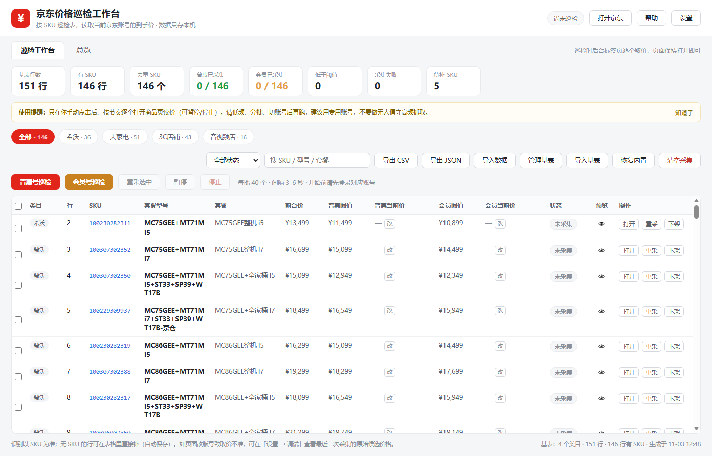
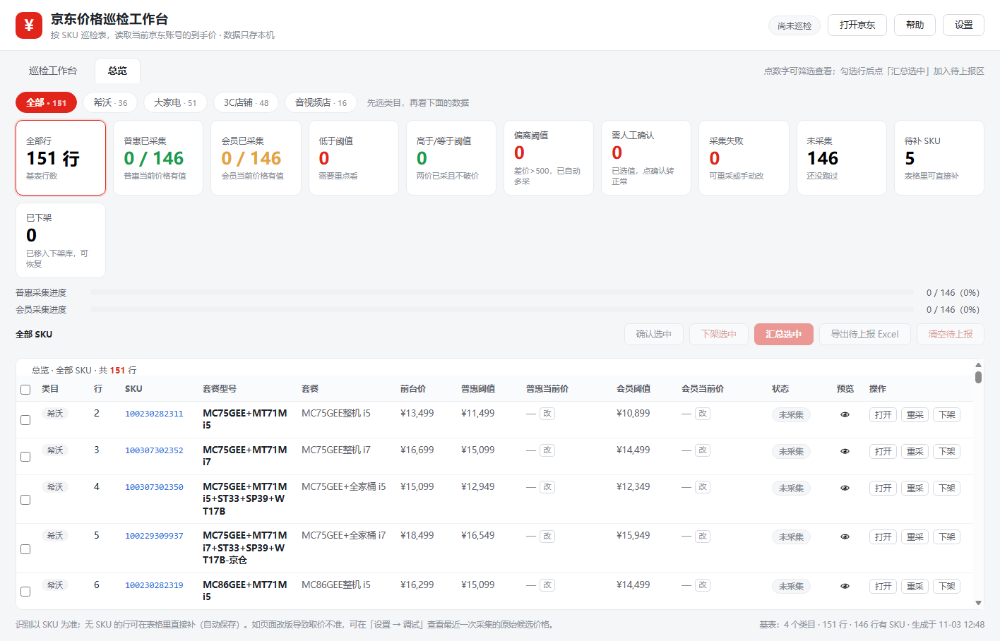

# 电商平台价格巡检工作台（Edge 扩展 v1.0）

按《SKU巡检表.xlsx》的 4 个类目（品牌A / 大家电 / 3C店铺 / 音视频店）批量巡检商品页面价格：

- 在 Edge 登录**普惠账号**跑一遍，填「普惠当前价格」；
- 切换登录 **PLUS 会员账号**再跑一遍，填「会员当前价格」；
- 每行自动对照基表里的「普惠最低到手价 / 会员最低到手价」阈值，低于阈值标红；
- 结果可导出 CSV，再用 `tools/apply_results_to_xlsx.py` 回填到 Excel 副本；
- 新增「总览」页：类目在上、数据在下，实时进度 + 点数字筛选（低于阈值/高于阈值/失败/未采/已下架等）；
- 新增汇总上报：勾选行 → 汇总 → 浅红底色进入「待上报区」→ 一键导出 Excel；
- 新增「小眼睛」预览：悬停可弹出商品页小窗直接核对，不用开链接再关；
- 新增「下架库」：已下架商品点「下架」移入下架库（默认隐藏、不再巡检），可随时恢复。

数据只存在本机浏览器（`chrome.storage.local`），不经过任何服务器。


## 界面预览



总览页（点数字可筛选查看）：



---

## 一、安装

1. Edge 地址栏打开 `edge://extensions/`；
2. 打开左下角「开发人员模式」；
3. 点「加载解压缩的扩展」，选择本文件夹：
   `~/Desktop/巡检\巡检插件版\extension`

   > 从旧路径换到新路径后，扩展 ID 会变（浏览器按路径生成），原有采集数据不会自动带过来：先在旧版「导出 JSON」，新版里点「导入数据」恢复即可。
4. 把「电商平台价格巡检工作台」固定到工具栏；
5. 点扩展图标 → 会打开一个整页的「工作台」（也可以直接打开 `chrome-extension://<扩展ID>/app.html`）。

> 以后更新代码：在 `edge://extensions/` 里点该扩展的「重新加载」。

## 二、使用流程

1. **确认基表**：工作台首次打开会自动加载内置基表（当前来自最新版 `SKU巡检表.xlsx`：4 类目、**151 行、146 行有 SKU（已按 SKU 去重）、5 行待补**）。
   - 行显示紫色「待补 SKU」的，表示 Excel 里该行没有 SKU，可在表格里直接补（纯数字，自动保存）；
   - 基表导入时已按 SKU 去重（新表 3C店铺 里 13 组重复 SKU 已自动合并，保留最后一条数据）；如果它们其实是不同商品，需要回 Excel 修正 SKU；
   - 如果以后 `SKU巡检表.xlsx` 有更新，重新生成基表再「导入基表」即可（见第四节）。
2. **巡检普惠价**：
   - 先在 Edge 登录**普通/普惠**电商平台账号；
   - 点「普惠号巡检」→ 确认弹窗（SKU 数量、预计耗时）→ 开始；
   - 工作台会在**后台标签页**按节奏逐个打开商品页、读取页面价格，可随时「暂停 / 继续 / 停止」；
   - 结束后「普惠当前价格」列会填上，并显示价格类型（到手价/电商平台价）与采集时间。
   > 第一次用建议先在「设置」里把「每次最多采集」改成 **5**，小批量试跑，确认取到的价格和商品页一致，再把数量调大。也可先把「巡检范围」设为「当前类目」分批跑。
3. **巡检会员价**：
   - 在 Edge 里退出普惠账号，登录 **PLUS 会员账号**；
   - 点「会员号巡检」，重复一次；
   - 同一批商品的普惠价和会员价会并排显示。
4. **查看与核对**：
   - 点 SKU 或「打开」→ 新标签打开商品页人工核对；
   - 某一行的价格可疑时，点这一行的「重采」→ 按上次巡检的身份只重采这一条；
   - 要批量重采：勾选多行（表头复选框 = 全选当前筛选）→ 点「重采选中」；
   - 采不到或价格不对，可以直接点每格价格右侧的「改」手动修正（会记为「手动」，不再算自动采集）；
   - 状态列：低于阈值（红）/ 正常 / 部分采集 / 采集失败 / 未采集 / 待补 SKU；
   - 顶部统计条会显示已采集数量、低于阈值数量、失败数量；
- 「需人工确认」的行核对后点「确认」即可转为「正常」状态。
5. **总览页**（重点）：
   - 点顶部「总览」→ 最上面是类目切换（全部 / 品牌A / 大家电 / 3C店铺 / 音视频店），选完类目再看下面的数字和表格；
   - 11 个数字卡片（全部行 / 普惠已采 / 会员已采 / 低于阈值 / 高于等于阈值 / 偏离阈值 / 需人工确认 / 失败 / 未采 / 待补 / 已下架）；
   - 点任意数字即可筛选下方表格查看对应行，再点一次取消；
   - 采集过程中进度条和数字实时更新；表格里同样能「改价 / 重采 / 打开」。
6. **核对与下架**：
   - **小眼睛预览**：表格右侧「预览」列的眼睛，鼠标悬停约 0.6 秒会弹出商品页小窗，移开自动关闭；点一下眼睛可固定小窗（再点关闭/关窗口），方便核对价格；
   - **下架库**：确认商品已下架，点操作列「下架」→ 移入下架库，默认从表格隐藏且**下次巡检不会再出现**（按行号和 SKU 双记录，重新生成/导入基表后依然排除）；在状态筛选选「已下架」或总览点「已下架」卡片可查看，点「恢复」放回来；「导出 JSON」会一并保存下架清单。
7. **汇总上报**：
   - 在总览页勾选要上报的行（表头复选框全选当前筛选）→ 点「汇总选中」；
   - 被汇总的行会变成**浅红底色**，并进入下方「待上报区」；
   - 点「导出待上报 Excel」直接下载 `SKU巡检表-待上报-日期.xlsx`（真正的 xlsx，可直接打开/上报）；
   - 「清空待上报」只清汇总标记，不删采集数据。
8. **导出与备份**：
   - 「导出 CSV」→ `SKU巡检表-巡检结果-日期.csv`（含待上报标记列）；
   - 「导出 JSON」→ `SKU巡检表-巡检数据-日期.json`（完整采集数据 + 手动改价 + 待上报区，换电脑/重装时用「导入数据」恢复）；
   - 「帮助」按钮里有完整上手说明。
9. **回填 Excel**（可选）：
   ```
   python tools\apply_results_to_xlsx.py "~/Desktop/SKU巡检表-巡检结果-20261102.csv"
   ```
   会在原 Excel 旁边生成 `SKU巡检表-巡检结果-日期.xlsx` 副本；脚本按表头识别各 sheet 的价格列（音视频店列顺序不同也能写对），低于阈值的单元格标红。

### 设置
右键工作台右上「设置」：
- **每次最多采集**：默认 40 个（0=全部）。151 个去重 SKU 全量约需 20–30 分钟；
- **间隔秒数**：默认 3–6 秒（随机）；
- **跳过今天已采集**：默认开，方便分批续跑；
- **巡检范围**：全部类目 / 当前类目；
- **预览悬停延迟**：鼠标停在「预览」小眼睛上多少毫秒后弹出商品页小窗（默认 1000，范围 300–5000）；
- **调试**：查看最近一次采集的原始价格候选，可一键「复制调试 JSON」（页面改版时发给我排查用）；
- **价格偏离阈值**：默认「差价 > 500 元 → 自动多采 3 次，取最接近阈值的值」；「差价 > 1500 元 → 仍会自动选最接近阈值的值，状态显示『需人工确认』」；点价格旁的「确认」按钮即可把状态改为「正常」（也可在总览页勾选后点「确认选中」批量确认）。这几个数字都可以在设置里改。

## 三、价格口径与取数说明

| 字段 | 来源 |
|---|---|
| 前台价格 / 普惠最低到手价 / 会员最低到手价 | 基表原值（阈值） |
| 普惠当前价格 | 用普惠账号巡检时，页面读取的「到手价」（页面没有到手价标签时取电商平台价） |
| 会员当前价格 | 用 PLUS 会员账号巡检时，页面读取的「到手价」（没有到手价标签时优先取 PLUS 会员价，再回退电商平台价） |
| 价格类型 | 到手价 / PLUS价 / 电商平台价 / 手动 |

> 页面显示的价格受账号、地址、券影响；插件读的是「当前登录账号在当前页面看到的价格」，并在每格标注采集时间和账号。页面偶尔会在价格上做千人千面，属于正常现象。
> 破价判断规则：当前价格 **低于**「最低到手价」才标红（等于阈值不算破价）。
>
> **关于「第一次读到 5」与价格读错**：电商平台商品页价格是异步渲染的，数字可能有动画/占位；另外页面同时存在「到手价（大号红字）」和「划线电商平台价」两个数字，划线价不是实际到手价。现在做这些处理：① 只等到价格连续两次稳定一致才上报（最多 20 秒）；② 识别并**跳过划线价/原价**（`<del>`、`<s>`、`line-through` 样式）；③ 优先按「到手价 / 电商平台价 / PLUS会员价」标签定位价格；④ 过滤「5折/5期/满5件/单个数字片段」，价格低于前台价 25% 判为不可信；⑤ 价格与阈值相差超过 500 元 → 自动多采 3 次、取最接近阈值的值；⑥ 若最接近的值仍相差超过 1500 元，**仍会记录该最接近值**，状态列显示「需人工确认」；核对无误后点价格格里的「确认」→ **无论价格高低/是否低于阈值，状态都变成「正常」**，标「✓ 已人工确认」；之后重新采集会重置这个确认（需要重新确认）。
> 如果某条依旧失败/可疑，点「重采」或「改」手动修正即可；也可以在总览页点「需人工确认」数字集中查看。

## 四、更新基表

### 直接导入 Excel（工具栏「导入基表」）

- 点「导入基表」→ **直接选 `.xlsx` 巡检表**（也兼容之前导出的基表 JSON）；
- 插件内置了一个轻量 Excel 解析器，会自动：
  - 读取每个 sheet（sheet 名 = 类目）；
  - 按表头名称识别 `sku / 套餐型号 / 套餐 / 前台价格 / 普惠最低到手价 / 普惠当前价格 / 会员最低到手价 / 会员当前价格`（列顺序随意，缺列也行）；
  - **按 SKU 去重**：重复 SKU 合并为一条，保留最后一条数据；
  - 显示「类目数 / 行数 / 有 SKU 行数」确认后再覆盖。
- 导入后立即生效；已采集的价格按 SKU 保留。想还原：点「恢复内置」。
- 表头要求：至少要有 `sku` 和 `套餐型号` 两列，SKU 为纯数字。

### 在插件里直接管理基表（工具栏「管理基表」）

不用改 Excel 也能维护基表：

- 点工具栏「**管理基表**」→ 弹出基表管理窗口；
- 支持：
  - **改**：SKU、套餐型号、套餐、前台价、普惠最低到手价、会员最低到手价（直接输入）；
  - **增**：当前类目下「新增一行」，填完保存即可参与巡检；
  - **删**：每行「删除」；
  - **类目**：新增类目 / 重命名类目 / 删除类目；
  - **导出基表 JSON**：先备份再改，或发给别人复用；
  - 「保存修改」后立即生效（巡检、统计、表格都更新）；「恢复内置」可还原成扩展自带的基表。
- 改动保存在本机（chrome.storage），换电脑/重装前请用「导出基表 JSON」备份；
- 如果之后又用新版 Excel 重新生成 JSON 并「导入基表」，会覆盖这些手动改动，建议先导出备份。

### 新增 SKU 的两种方式

**方式 A（推荐，适合批量）：改 Excel → 生成 JSON → 导入**

1. 把新 SKU 按现有格式加进 `SKU巡检表.xlsx`（一行一个 SKU，SKU 纯数字）；
2. 运行：
   ```powershell
   python 巡检插件版\extension\tools\build_base_from_xlsx.py
   ```
   默认读 `~/Desktop/SKU巡检表.xlsx`，生成 `巡检插件版\extension\data\base-skus.json`；
3. 工作台点「导入基表」选这个 JSON；或替换 `data\base-skus.json` 后到 `edge://extensions/` 重新加载扩展。

> 表头是**按名称识别**的，不是按固定列号：必须有 `sku` 和 `套餐型号` 两列；`套餐 / 前台价格 / 普惠最低到手价 / 普惠当前价格 / 会员最低到手价 / 会员当前价格` 可缺、顺序随意；sheet 名就是「类目」；SKU 重复时只采一次。

**方式 B（少量临时）：表格里直接补**

工作台表格里显示「待补 SKU」的行，可直接在 SKU 格输入纯数字补齐（自动保存）；补好后就能参与巡检。

> 插件本身不能直接读 .xlsx（浏览器没有 Excel 解析库），所以要么走方式 A 的脚本转换，要么补 SKU。如果你想要「插件里直接追加单个 SKU」的按钮或 CSV 导入，我可以加。

`SKU巡检表.xlsx` 改完后，重新生成扩展内置基表：

```powershell
python 巡检插件版\extension\tools\build_base_from_xlsx.py
```

生成 `巡检插件版\extension\data\base-skus.json`，然后在工作台点「导入基表」选择该 JSON（或重新加载扩展使用内置版本）。

> 生成脚本和回填脚本现在都**按表头名称识别列**，所以各个 sheet 的列顺序可以不同（比如「音视频店」没有「套餐」列、当前价格列在第 5/7 列也能正确处理），不再依赖固定列号。

## 五、合规与风控提醒

- 插件只在你手动点击后才工作，**后台打开商品页读取已渲染的页面价格**，不调用电商平台接口、不提交订单、不修改任何数据；
- 默认节奏 3–6 秒/个，并支持分批、暂停、停止——请保持低频，别做无人值守的高频抓取；
- 建议用**专用账号**采集，主账号只做人工查看；
- 如果日志出现「页面要求安全验证」，请停止巡检、降低频率，不要连续硬跑；
- 定时/全量自动化仍建议走已打通的官方 API（普惠价），插件定位是**账号视角的会员价/页面价人工巡检与对账**。

## 六、常见问题

| 现象 | 处理 |
|---|---|
| 加载扩展报 `Cannot load extension with file or directory name _dev` | 扩展目录里不能有 `_` 开头的文件/文件夹。调试脚本在 `巡检插件版/dev-tools/`；不要放回 `extension/` |
| 点扩展图标没反应 | `edge://extensions/` 确认已启用；重新加载扩展（路径是 `巡检插件版\extension`） |
| 换路径/重装后采集数据没了 | 扩展 ID 跟路径绑定，旧数据不会带过来。如果之前「导出 JSON」过，点「导入数据」选择 JSON 即可恢复采集/手动改价/待上报区；没有备份就只能重跑 |
| 巡检一直「等待页面价格超时」 | 确认 Edge 已登录、能正常打开商品页；或先在设置里把每次数量调小试跑；检查是否被跳到了登录页 |
| 采到「5」或明显不对的价格 | 已加「价格稳定等待 + 跳过划线价 + 标签定位 + 疑似不完整过滤」，仍不对的会显示失败而不是写错误价；点这一行的「重采」或价格旁的「改」手动修正；也可勾选多行「重采选中」 |
| 出现「偏离阈值 / 需人工确认」标记 | 采集价与阈值的差价超过了设置值：500 元会自动多采 3 次取最接近阈值的值；仍超过 1500 元会**记录该选值**，状态显示「需人工确认」。核对无误点价格格里的「确认」→ 状态变「正常」；要改价点「改」。也可在总览勾选后点「确认选中」批量确认 |
| 同一 SKU 出现在多行 | 巡检按 SKU 去重只采一次；若这些行其实是不同商品，请回 Excel 修正 SKU 后重新生成基表 |
| 采集失败 / 价格明显不对 | 打开「设置 → 调试」复制原始候选价格发我，按页面结构调整识别规则 |
| 某行没有 SKU | 在表格里直接补 SKU（自动保存）；或回原 Excel 补齐后重新生成基表 |
| 汇总/回填 Excel 失败 | 确认 CSV 是工作台导出的、列名未被改动；确认 Python 有 openpyxl（本机已内置） |

## 七、文件结构

```
extension/
├── manifest.json          # MV3 扩展配置
├── background.js          # 点图标打开/复用工作台
├── app.html / app.css / app.js   # 工作台（表格、巡检控制、导出）
├── content.js             # 商品页取价脚本（只读 DOM）
├── data/base-skus.json    # 由 Excel 生成的基表
├── docs/preview.png       # 界面截图（工作台）
├── docs/preview-overview.png # 界面截图（总览页）
├── icons/                 # 图标
└── tools/
    ├── build_base_from_xlsx.py   # Excel → base-skus.json（按表头自适应列名）
    └── apply_results_to_xlsx.py  # 导出的 CSV → 回填 Excel 副本（按表头自适应列名）
```

> ⚠️ 注意：Edge/Chromium **不允许扩展目录里存在以 `_` 开头的文件或文件夹**（会报 `Cannot load extension with file or directory name _xxx`）。调试脚本已放在同级的 `dev-tools/`，不要放回 `extension/` 里面。
